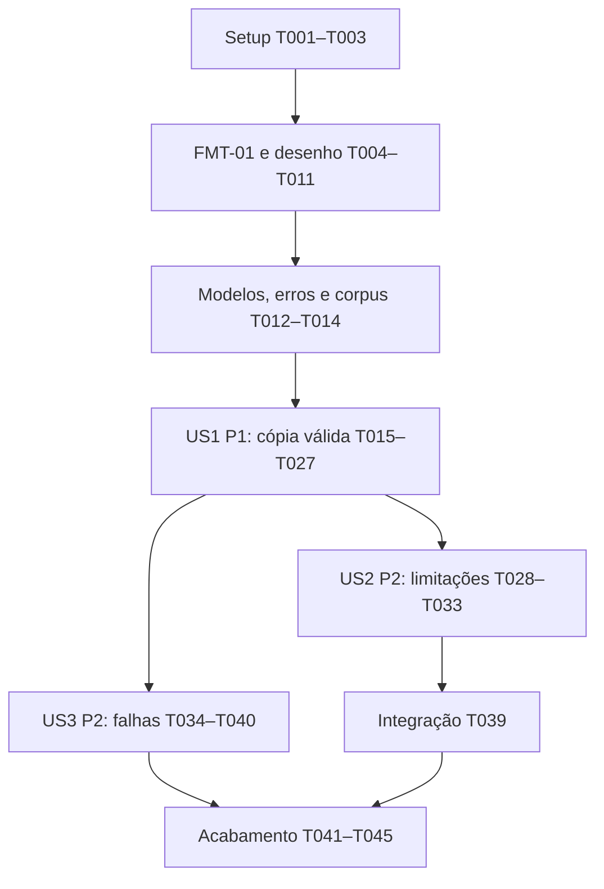

# Tasks: Redução de conflitos visuais em grafos do Twine

**Input**: `specs/001-reduce-edge-overlap/spec.md`, `plan.md`, `research.md` e constituição 1.0.1.

**Revisão**: Sincronizada com o plano que define EVAL-01 antes dos experimentos e o
entry point `twine_edge_overlap.cli:main`. IDs das 45 tarefas preservados; progresso
de implementação registrado nas caixas e no registro de execução ao final.

**Prerequisites**: Especificação e plano carregados. FMT-01 fechado para o perfil observado;
`data-model.md`, `contracts/` e `quickstart.md` concluídos em T008–T011. As tarefas T004–T011
fecharam a lacuna de desenho antes da implementação das histórias. A geração desta lista
não significa aprovação do formato, do motor ou dos gates do plano.

**Tests**: Incluídos porque a especificação exige cenários de aceitação verificáveis,
preservação, métricas e tratamento de falhas. Escrever os testes antes do comportamento
correspondente e confirmar que falham pelo motivo esperado antes de implementá-lo;
falhas apenas de importação não demonstram o contrato. Não exigir TDD para documentação.

**Organization**: Preparação, fundamentos, US1 (P1), US2 (P2), US3 (P2) e acabamento.
Cada história tem um critério independente de validação, ainda que compartilhe infraestrutura.

**Execution status**: T001–T003 concluídas como preparação do projeto. A instalação editável
não pôde ser validada por restrição de rede ao baixar o backend; configuração e importação
direta foram verificadas. T004 concluída com a amostra `.twee` fornecida pelo usuário;
T005 concluída com caracterização, preservação e reabertura confirmada pelo usuário.
T006–T014 concluídas após leitura do ZIP Twine 2.12.1, comparação curva, desenho e corpus.
T001–T045 concluídas: CLI funcional com Graphviz e 69 testes aprovados. O usuário confirmou
a reabertura dos seis casos de referência (T027) e escolheu Apache-2.0 (T041). Inventário,
quickstart por código-fonte e rastreabilidade final conferidos. Instalação editável opcional
não foi validada e permanece fora do fluxo de entrega verificado.

## Format: `[ID] [P?] [Story] Description`

- `[P]` indica tarefas em arquivos distintos que podem ser feitas juntas **depois de
  cumpridas suas dependências**; não autoriza atravessar FMT-01 ou outros checkpoints.
- `[US1]`, `[US2]` e `[US3]` referenciam as histórias da especificação.
- Todos os caminhos abaixo são relativos à raiz do projeto.
- Caixas marcadas representam tarefas executadas; limitações de validação estão no registro final.

## Path Conventions

Um pacote Python em `src/twine_edge_overlap/`; testes em `tests/`; experimentos descartáveis
em `experiments/`; documentação de desenho em `specs/001-reduce-edge-overlap/`.
`formats/profile.py` representa somente o perfil `.twee` documentado e validado.

## Phase 1: Setup (Shared Infrastructure)

**Purpose**: Preparar o projeto sem presumir o formato nem instalar binários automaticamente.

- [X] T001 Inicializar `pyproject.toml` e `src/twine_edge_overlap/__init__.py` para Python 3.12 ou posterior, pacote CLI `twine-edge-overlap` com entry point `twine_edge_overlap.cli:main` e pytest como dependência de desenvolvimento; não adicionar bindings C, NetworkX ou ELK.js ao runtime sem decisão posterior em T007.
- [X] T002 [P] Criar `README.md` e `CONTRIBUTING.md` com preparação do ambiente Windows, execução futura via terminal e verificações locais, explicando que o suporte `.twee` depende de FMT-01 e distinguindo comandos de desenvolvimento de funcionalidades ainda não implementadas; depende de T001.
- [X] T003 [P] Criar `docs/third-party.md` com inventário proposto de Python, Graphviz e pytest, ELK.js apenas como alternativa experimental e licença autoral ainda pendente, registrando origem e modo de uso sem afirmar compatibilidade final; depende de T001.

**Checkpoint**: Estrutura e instruções disponíveis; preparação pode ocorrer antes da amostra.

## Phase 2: Foundational (Blocking Prerequisites)

**Purpose**: Resolver o formato, concluir o desenho e fornecer os contratos comuns.

**CRITICAL**: T004 depende de um arquivo real fornecido pelo usuário. Sem ele, registrar
o bloqueio e não fabricar uma amostra como prova de compatibilidade. Não implementar
nenhuma história antes de T011–T014. Licença autoral pendente bloqueia distribuição
pública, não a caracterização local de um arquivo autorizado.

- [X] T004 Obter do usuário uma amostra real de arquivo do Twine e registrar em `tests/fixtures/README.md` sua origem, hash, aplicativo/versão quando identificável e condições de uso em testes; amostra recebida em `.twee`, formato aprovado pelo usuário para entrada/saída, sem autorização de redistribuição presumida e mantida somente no caminho local; depende de T001.
- [X] T005 Caracterizar a amostra e registrar em `specs/001-reduce-edge-overlap/format-validation.md` estrutura, codificação, número de histórias, campos visuais mutáveis e invariantes; experimentar em cópia uma alteração visual mínima, reabrir no editor alvo e confirmar posições, tamanhos, traçados, laços, sentidos opostos e ligações estáticas/dinâmicas; anexar evidências de preservação e marcar FMT-01 fechado em `specs/001-reduce-edge-overlap/research.md` somente se todos os critérios do gate forem satisfeitos; depende de T004.
- [X] T006 Criar `experiments/compare_layouts.py` como ensaio isolado após FMT-01, aplicando antes da primeira chamada o orçamento EVAL-01 de `specs/001-reduce-edge-overlap/plan.md`, com prazos globais, leitura limitada de stdout/stderr e encerramento dos processos; comparar original, Graphviz `dot` e ELK.js no mesmo corpus experimental derivado da amostra e de exemplos válidos do perfil, com o desenho real do editor; registrar casos, versões, opções, três contagens, tempo, preservação e casos limitados/não comparados em `specs/001-reduce-edge-overlap/layout-comparison.md`, sem depender do código de produção ou de T014, aceitar SVG como evidência de melhoria ou criar algoritmo de layout próprio; depende de T005.
- [X] T007 Consolidar em `specs/001-reduce-edge-overlap/plan.md` e `research.md` a escolha sustentada por T006, versões de Python e motor, estratégia de preservação, publicação sem sobrescrita no Windows e valores finitos para tempo, tamanho, nós, arestas, saída do subprocesso e tolerâncias geométricas do produto; separar esses valores dos limites experimentais EVAL-01 já aplicados em T006 e justificar qualquer revisão sem alegar capacidade não medida; atualizar `docs/third-party.md` com as versões e licenças verificadas; se o vencedor exigir mudar arquitetura ou escopo, atualizar o desenho antes das tarefas de implementação e revisar esta lista; depende de T003 e T006.
- [X] T008 Concluir `specs/001-reduce-edge-overlap/data-model.md` com snapshot original, grafo semântico e projeção visual distintos, IDs e multiarestas preservados, layout, três contagens, capacidades do perfil e resultado; definir campos, unidades, limites, transições e invariantes conforme o perfil de T005 e decisões de T007, sem representar ligações dinâmicas como resolvidas por execução de scripts; depende de T007.
- [X] T009 [P] Definir `specs/001-reduce-edge-overlap/contracts/cli.md` com exatamente um caminho posicional, Unicode, destino padrão, nome sem colisão, caminho absoluto, três contagens antes/depois, mensagens e códigos de saída distintos para sucesso completo, limitações e falha, incluindo ausência de saída válida e interrupção; depende de T008.
- [X] T010 [P] Definir `specs/001-reduce-edge-overlap/contracts/format-profile.md` com identificação inequívoca do formato, versão do editor, campos permitidos, extração de conexões, geometria das arestas, conversão de unidades, política para campos desconhecidos, múltiplas histórias e falhas de integridade; rejeitar casos fora do perfil sem conversão silenciosa; depende de T008.
- [X] T011 Concluir `specs/001-reduce-edge-overlap/quickstart.md` com comandos de instalação, execução e validação no Windows e resultados esperados; reavaliar em `plan.md` os seis princípios após o desenho e registrar a Fase 1 concluída somente com FMT-01 e contratos resolvidos; conferir esta lista contra os novos contratos e ajustar tarefas se necessário antes de continuar; depende de T009 e T010.
- [X] T012 [P] Implementar os modelos comuns em `src/twine_edge_overlap/domain/model.py` e o pacote `domain/__init__.py` conforme `data-model.md`, incluindo identidade semântica independente da projeção visual, coordenadas finitas e contagens inteiras não negativas, preservação de direção e multiplicidade e resultado sem caminho válido em caso de falha; transcrever para esta tarefa quaisquer novas restrições de campo do modelo antes de codificar; depende de T011.
- [X] T013 [P] Implementar categorias de erro e causas em `src/twine_edge_overlap/errors.py` conforme os contratos, distinguindo entrada, formato, dependência ausente, timeout, integridade, escrita e cancelamento sem executar scripts da história nem produzir mensagens de sucesso; depende de T011.
- [X] T014 [P] Criar corpus autorizado do perfil em `tests/fixtures/cases.json` e arquivos referenciados sob `tests/fixtures/`, com hashes e contagens esperadas: cruzamento, trecho coincidente, layout limpo, vazio válido quando permitido, nós isolados/sobrepostos, travessias de nós conectados e isolados, contato de borda, ciclos, laços, multiarestas, relações opostas, Unicode e metadados; incluir disposições sem conflitos conhecidas para SC-003, SC-007 e SC-008; depende de T011.

**Checkpoint**: FMT-01 comprovado, desenho concluído, contratos definidos e corpus disponível.
Se T005 revelar incompatibilidade com a extensão/saída exigida, esclarecer o escopo antes
de fechar o gate. T007 não deve promover uma recomendação documental sem evidência.

## Phase 3: User Story 1 - Obter uma cópia com arestas mais legíveis (Priority: P1) — MVP

**Goal**: Executar um comando, melhorar o layout e gerar uma cópia íntegra sem sobrescrita.

**Independent Test**: Usar os exemplos resolvíveis do corpus, abrir a saída no editor
compatível e demonstrar redução das métricas, sucesso completo quando as três forem zero,
original idêntico byte a byte e igualdade de conteúdo, IDs, metadados e conexões.

### Tests for User Story 1

- [X] T015 [P] [US1] Escrever testes de contrato do comando e do sucesso completo em `tests/contract/test_cli_success.py`, cobrindo um caminho com espaços/acentos, caminho absoluto de saída e três contagens antes/depois conforme `contracts/cli.md`; depende de T012–T014.
- [X] T016 [P] [US1] Escrever testes de leitura/gravação e preservação em `tests/integration/test_roundtrip.py`, verificando original byte a byte, conteúdos escapados, scripts, estilos, tags, IDs, atributos desconhecidos preserváveis, direção e multiplicidade, e cópia reabrível pelo perfil; depende de T012–T014.
- [X] T017 [P] [US1] Escrever casos geométricos com resultados conhecidos em `tests/unit/test_geometry.py` para cruzamentos, trechos coincidentes, encontro normal em nó comum, sobreposição de área positiva entre nós e travessia de nó alheio; contar cada par uma vez e excluir contato só na borda conforme a especificação e tolerância contratada; depende de T012–T014.
- [X] T018 [P] [US1] Escrever testes do adaptador de motor em `tests/unit/test_graphviz.py`, cobrindo IDs sintéticos estáveis, nós de tamanho fixo, multiarestas sem `strict`, labels vazios, saída `json0`, coordenadas centro/canto, unidades e inversão de Y, sem expor conteúdo em DOT nem tomar rotas não suportadas como resultado final; depende de T012–T014 e da confirmação de Graphviz em T007.
- [X] T019 [P] [US1] Escrever testes de nova cópia em `tests/unit/test_files.py` para destino na pasta de entrada, nomes distintos em execuções repetidas, colisão de nome durante publicação, original somente para leitura e publicação somente após validação; depende de T012–T014.
- [X] T020 [P] [US1] Escrever testes em `tests/unit/test_selection.py` aceitando apenas candidatos sem aumento em nenhuma das três métricas, inclusive após arredondamento e serialização; verificar fallback ao layout original, baseline sem conflitos e comparação por pares, sem compensação entre métricas; depende de T012–T014.

### Implementation for User Story 1

- [X] T021 [P] [US1] Implementar `src/twine_edge_overlap/formats/profile.py` e `formats/__init__.py` para ler somente o perfil comprovado, extrair grafo/projeção sem executar conteúdo e aplicar apenas mudanças visuais autorizadas ao documento original; validar invariantes depois de serializar e preservar campos desconhecidos suportados; depende dos fundamentos e de T016.
- [X] T022 [P] [US1] Implementar o avaliador puro em `src/twine_edge_overlap/domain/geometry.py` com a geometria comprovada do editor, três contagens por pares distintos, exclusões de borda/extremos e tolerância contratada, sem I/O ou dependência do subprocesso; depende dos fundamentos e de T017.
- [X] T023 [P] [US1] Implementar `src/twine_edge_overlap/engines/graphviz.py` e `engines/__init__.py` com DOT apenas geométrico, execução sem shell, parâmetros e orçamento de T007, leitura de `json0` com validação de IDs e coordenadas e conversão contratada; tratar capacidades ausentes como erro e não usar splines que o perfil não persiste; depende dos fundamentos e de T018.
- [X] T024 [P] [US1] Implementar snapshot de entrada e publicação de nova cópia em `src/twine_edge_overlap/files.py` com reserva/publicação sem sobrescrita segundo a estratégia de T007, preservação do original e resultado válido anunciado somente após gravação completa e validação; depende dos fundamentos e de T019.
- [X] T025 [US1] Implementar `src/twine_edge_overlap/domain/selection.py` para comparar baseline e candidatos pela geometria final serializada, aceitar somente não regressão nas três métricas e escolher deterministicamente entre melhorias admissíveis segundo `data-model.md`, mantendo baseline quando necessário; depende de T020–T023.
- [X] T026 [US1] Integrar o fluxo em `src/twine_edge_overlap/application.py` e `cli.py`: um caminho, snapshot, leitura, baseline, motor, candidato, serialização, releitura, verificação semântica/geométrica e nova cópia; apresentar caminho, métricas e sucesso apenas com três zeros, expondo o entry point de T001 e mantendo acesso a arquivos fora do domínio; depende de T015 e T021–T025.
- [X] T027 [US1] Executar testes US1 e reabertura dos exemplos resolvíveis, registrar evidências e versões em `specs/001-reduce-edge-overlap/validation.md`, demonstrando SC-001 a SC-004, SC-006 a SC-008 para os casos de sucesso e ausência de novos conflitos em layout inicialmente limpo; corrigir falhas antes de marcar US1 concluída; depende de T026.

**Checkpoint**: US1 utilizável e validada por fluxo completo. Mesmo no MVP, uma saída
com conflitos não pode ser rotulada como sucesso completo nem uma falha como saída válida.

## Phase 4: User Story 2 - Compreender uma melhoria parcial ou um limite (Priority: P2)

**Goal**: Distinguir melhoria parcial, ausência de melhoria e limite sem saída íntegra.

**Independent Test**: Injetar um motor controlado ou usar um grafo com limitação conhecida;
verificar cópia íntegra, três contagens sem regressão, estado correto e causa conhecida,
sem depender de o motor real falhar espontaneamente.

### Tests for User Story 2

- [X] T028 [P] [US2] Escrever `tests/contract/test_cli_limitations.py` com mensagem e código de saída de limitações, caminho válido e três contagens separadas; incluir arestas sem conflitos com sobreposição de nós ou travessia remanescente e proibir alegação de impossibilidade matemática não demonstrada; depende da fundação e de T027.
- [X] T029 [P] [US2] Escrever `tests/integration/test_limited_results.py` para melhoria parcial, ausência de melhoria, todos os candidatos rejeitados e orçamento esgotado com/sem baseline íntegro; verificar fallback sem regressão, original preservado e ausência de caminho válido quando integridade não for garantida; depende da fundação e de T027.

### Implementation for User Story 2

- [X] T030 [US2] Implementar classificação de conclusão e razões em `src/twine_edge_overlap/domain/result.py`, distinguindo três métricas zeradas, qualquer conflito remanescente e ausência de cópia íntegra; definir melhoria parcial como redução de pelo menos um par sem aumento das outras métricas; depende de T028 e T029.
- [X] T031 [US2] Completar `src/twine_edge_overlap/application.py` com orçamento global de T007 e fallback íntegro para layouts não melhorados ou timeout recuperável; diferenciar limitação de processamento de erro sem saída válida e conservar somente candidatos semanticamente válidos; depende de T030 e T025.
- [X] T032 [US2] Completar `src/twine_edge_overlap/cli.py` com estado de limitações, causa conhecida, ausência explícita de melhoria quando aplicável e contagens de pares de arestas, pares de nós e pares aresta–nó antes/depois conforme o contrato; depende de T031.
- [X] T033 [US2] Validar os cinco cenários de US2 e SC-004/SC-005 em `tests/integration/test_limited_results.py` e registrar evidências em `specs/001-reduce-edge-overlap/validation.md`, garantindo que conflitos só entre nós ou aresta–nó impedem sucesso completo; depende de T032.

**Checkpoint**: Limitações compreensíveis e verificáveis sem regressão do caminho feliz.

## Phase 5: User Story 3 - Reconhecer e corrigir uma falha (Priority: P2)

**Goal**: Recusar solicitações inválidas e comunicar falhas sem perda ou falsa saída válida.

**Independent Test**: Invocar o CLI com entradas inválidas e falhas de processo/arquivo
controladas; verificar causa, código de falha, original intacto e nenhuma saída parcial
apresentada como válida. Falhas de processo são testadas sem depender de US2.

### Tests for User Story 3

- [X] T034 [P] [US3] Escrever `tests/contract/test_cli_failures.py` para zero/múltiplos caminhos, diretório, caminho inexistente, variante não suportada, conteúdo corrompido, referências inválidas e dependência ausente; conferir códigos e mensagens contratuais sem path de sucesso; depende da fundação e de T027.
- [X] T035 [P] [US3] Escrever `tests/integration/test_file_failures.py` injetando ausência de permissão de leitura/escrita, falta de espaço, escrita parcial, falha de publicação e interrupção; verificar hashes dos arquivos preexistentes e que artefato incompleto não é anunciado como válido; depende da fundação e de T027.
- [X] T036 [P] [US3] Escrever `tests/integration/test_engine_failures.py` com motor controlado para código de erro, timeout, saída excessiva, JSON inválido, IDs ausentes/duplicados e coordenadas não finitas; conferir distinção entre fallback válido e falha, sem executar scripts/macros nem abrir shell; depende da fundação e de T027.

### Implementation for User Story 3

- [X] T037 [P] [US3] Completar validação de entrada em `src/twine_edge_overlap/formats/profile.py` conforme o contrato: formato, identidades, referências, dimensões e layout, campos desconhecidos não preserváveis e múltiplas histórias; rejeitar sem descarte silencioso e sem executar código da história; depende de T034.
- [X] T038 [P] [US3] Completar tratamento de subprocesso em `src/twine_edge_overlap/engines/graphviz.py` e limpeza/publicação em `files.py`, aplicando timeout, limite de saída, encerramento do processo e preservação dos arquivos preexistentes, com erros tipados para os casos de T035 e T036; depende de T035 e T036.
- [X] T039 [US3] Integrar validações e erros em `src/twine_edge_overlap/application.py` e `cli.py`, recusando zero/múltiplas entradas, exibindo causa acionável e código correto, tratando interrupção sem sucesso falso nem traceback como única mensagem; preservar o fallback válido de US2 quando presente; depende de T037, T038 e, para integração final, T033.
- [X] T040 [US3] Executar os cenários US3 e regressões de US1/US2 em `tests/contract/` e `tests/integration/`, registrar em `specs/001-reduce-edge-overlap/validation.md` preservação do original e ausência de anúncio de saídas parciais em toda falha e interrupção observável; depende de T039.

**Checkpoint**: Histórias completas, inclusive entrada inválida, erro de escrita e falha de motor.

## Phase 6: Polish & Cross-Cutting Concerns

**Purpose**: Preparar uma entrega verificável, documentada e compatível com as licenças.

- [X] T041 Obter dos mantenedores a seleção explícita de licença autoral e registrar o texto em `LICENSE` e a identificação em `README.md`, conferindo compatibilidade com as versões/dependências efetivamente utilizadas e fechando a pendência correspondente na constituição via `$speckit-constitution`; não escolher licença em nome deles nem distribuir publicamente antes disso; depende de T003 e T007, e de informação dos mantenedores.
- [X] T042 [P] Finalizar `docs/third-party.md` com versões, licenças, avisos, links de fonte e inventário transitivo real; documentar instalação separada de Graphviz e excluir ELK.js do runtime se usado apenas no experimento; se houver proposta de redistribuir binários ou copiar código GPL/EPL, reavaliar expressamente essa mudança; depende de T040 e T041.
- [X] T043 [P] Atualizar `README.md`, `CONTRIBUTING.md` e `specs/001-reduce-edge-overlap/quickstart.md` com comandos executáveis, perfil suportado, instalação completa de Graphviz, limites medidos, estados e exemplos reais de saída, sem prometer resolução universal nem esconder limitações de análise estática; depende de T040 e T041.
- [X] T044 Executar o quickstart completo no Windows e a suíte adequada nas versões Python/motor declaradas, conferir preservação e reabertura no corpus, registrar contagens, tempos e limitações em `specs/001-reduce-edge-overlap/validation.md`; não anunciar suporte a plataformas ou versões não verificadas; depende de T042 e T043.
- [X] T045 Conferir rastreabilidade FR-001 a FR-012 e SC-001 a SC-008 em `specs/001-reduce-edge-overlap/validation.md`, revisar coerência de `spec.md`, `plan.md`, `research.md` e contratos, registrar os seis princípios e pendências reais de entrega e marcar concluídas somente as tarefas com evidência; depende de T044.

## Dependencies & Execution Order

### Phase Dependencies

1. T001 libera T002 e T003 em paralelo. T004 pode começar após T001 quando houver amostra.
2. T004 → T005 (FMT-01) → T006 → T007; T007 também requer T003.
3. T007 → T008 → {T009, T010} → T011 → {T012, T013, T014}.
4. Fundação completa libera US1. US1 concluída libera as extensões US2 e US3.
5. US2 e parte de US3 podem avançar juntas; a integração T039 espera T033 para evitar
   edição concorrente de `application.py`/`cli.py` e preservar os resultados com limitações.
6. T041 é uma dependência de distribuição; pode ser resolvida após T007, antes do acabamento.
   T042/T043 aguardam também T040; T044 e T045 encerram a entrega.

### User Story Dependencies

US2 e US3 são testáveis com motores e falhas controlados, mas reutilizam o fluxo de arquivo
de US1. Não são implementações isoladas do leitor/gravador. O grafo representa dependência
de entrega: dentro de US3, T034–T038 não precisam aguardar US2; T039 precisa.

### Within Each User Story

- US1: T015–T020 precedem seus respectivos comportamentos. T021–T024 são módulos distintos;
  T025 aguarda perfil, geometria e motor. T026 integra; T027 demonstra no editor.
- US2: {T028, T029} → T030 → T031 → T032 → T033.
- US3: {T034, T035, T036} → {T037, T038} → T039 → T040, com dependências adicionais acima.
- Testes do motor devem usar fakes para falhas e o motor real para a integração positiva;
  testes de geometria devem usar resultados conhecidos independentes do próprio motor.
- Se o modelo concluído em T008 introduzir novas restrições de campo, incorporá-las
  literalmente nas tarefas afetadas antes de executar a implementação (checkpoint T011).

### Parallel Opportunities

Grupos disponíveis após suas dependências: T002/T003; T009/T010; T012/T013/T014;
T015–T020; T021–T024; T028/T029; T034–T036; T037/T038; T042/T043.
Não paralelizar tarefas que editam `application.py`, `cli.py`, `validation.md` ou os mesmos
documentos de desenho. A existência desses grupos não solicita agentes automaticamente.

## Parallel Example: User Story 1

Depois da fundação, escrever T015 em `tests/contract/test_cli_success.py` e T017 em
`tests/unit/test_geometry.py` simultaneamente; são contratos distintos.
Depois dos respectivos testes, T021 (`formats/profile.py`), T022 (`domain/geometry.py`),
T023 (`engines/graphviz.py`) e T024 (`files.py`) podem avançar em arquivos separados.
Integrar somente em T025/T026 depois de todos os pré-requisitos.

## Parallel Example: User Story 2

Após US1, T028 (`tests/contract/test_cli_limitations.py`) e T029
(`tests/integration/test_limited_results.py`) podem ser escritos em paralelo. T030–T033
seguem a ordem por dependência; não dividir edições simultâneas do CLI e da aplicação.

## Parallel Example: User Story 3

Após US1, T034 (`test_cli_failures.py`), T035 (`test_file_failures.py`) e T036
(`test_engine_failures.py`) podem avançar em paralelo em seus diretórios de testes.
Após esses testes, T037 trata o perfil e T038 trata processo/arquivos; T039 integra
somente quando ambos e US2 estiverem concluídos.

## Implementation Strategy

### Requirement Coverage

| Requisito | Tarefas principais |
|---|---|
| FR-001 — caminho único e Unicode | T009, T015, T026, T034, T039 |
| FR-002 — validação e formato | T004–T005, T010, T016, T021, T034, T037 |
| FR-003 — redução de conflitos entre arestas | T006, T017–T018, T022–T023, T025–T027 |
| FR-004 — dados semânticos preservados | T005, T008, T016, T021, T026–T027 |
| FR-005 — original intacto | T016, T019, T024, T027, T035, T038, T040 |
| FR-006 — cópia válida, distinta e reabrível | T010, T016, T019, T021, T024, T027 |
| FR-007 — não regressão de arestas | T020, T025, T027, T029, T031 |
| FR-008 — estados, caminho e três contagens | T009, T015, T026, T028–T033, T039 |
| FR-009 — falha sem falsa saída válida | T013, T024, T029, T034–T040 |
| FR-010 — um arquivo por execução | T009, T026, T034, T039 |
| FR-011 — sobreposições entre nós | T014, T017, T020, T022, T025, T027, T028–T033 |
| FR-012 — travessias de nós alheios | T014, T017, T020, T022, T025, T027, T028–T033 |

SC-001/SC-002 são demonstrados por T016/T027/T035/T040; SC-003/SC-007/SC-008 por
T014/T017/T027; SC-004 por T020/T027/T029/T033; SC-005 por T015/T028/T033/T034/T040;
SC-006 por T019/T027/T034/T040. T044/T045 consolidam a aceitação de todos os critérios.

### MVP First (User Story 1 Only)

Concluir setup, FMT-01, desenho e fundação antes de construir US1. Validar uma cópia real
reabrível, sem alterações semânticas ou aumento das três métricas. O MVP é uma demonstração
local de US1; a primeira versão completa continua exigindo US2 e US3. O MVP nunca autoriza
mensagens de sucesso falsas nem sobrescrita do original. Publicação depende de T041.

### Incremental Delivery

Depois de US1, acrescentar comunicação e recuperação de limitações em US2 e falhas em US3.
Revalidar contratos anteriores a cada integração. Concluir documentação, licença e evidência
de aceitação antes de considerar a versão distribuível. Não implementar lote, interface
gráfica, conversão de formato, motor próprio ou nós artificiais como atalhos.

## Notes

Esta lista contém tarefas de recuperação do desenho porque os artefatos disponíveis são
parciais. T004 é o primeiro bloqueio externo conhecido; seu resultado não é inferível pela
extensão. As tarefas posteriores são sequenciadas para usar o perfil comprovado, sem
inventar o formato. Se a escolha de motor mudar em T007, revisar T018/T023/T036/T038
antes de executá-las. A lista foi criada por `$speckit-tasks`; a retomada de `$speckit-plan`
sincronizou somente T001 (entry point) e T006 (orçamento EVAL-01), sem marcar tarefas concluídas.
A revisão posterior por `$speckit-tasks` confirmou essas correções, explicitou o ponto de
início disponível e distinguiu em T007 limites finais do produto e orçamento experimental.

## Execution Record — 2026-10-16

### Estado consolidado mais recente

45/45 tarefas concluídas. T027 concluída pela confirmação A do usuário sobre os seis
exemplos reabertos no Twine web. 69 testes automatizados passaram. O usuário depois escolheu
B para licença: Apache-2.0, texto integral em LICENSE, aviso em NOTICE e constituição 1.0.1.
T042–T045 concluídas com inventário da composição por fontes, quickstart e rastreabilidade.
T028–T040 concluídas com testes específicos e correções, descritas em `validation.md`.
O histórico abaixo conserva as etapas e bloqueios anteriores, posteriormente resolvidos.

T044 validou o fluxo documentado por checkout no Windows com Python 3.14.6 e Graphviz
16.1.0: versão da CLI, exemplo sintético com 1/0/0 -> 0/0/0, preservação dos bytes,
69 testes e compileall. A instalação editável é alternativa opcional não exercitada;
nenhuma dependência externa é incorporada à composição entregue. Evidências em `validation.md`.

Restrições de T012 incorporadas ao modelo: coordenadas finitas módulo <=10^7, dimensões
0,001..10^6, 100 nós e 300 ocorrências, identidades únicas e referências existentes,
snapshot <=10 MiB, um intervalo de patch por nó, ordenados e sem sobreposição, contagens
inteiras não negativas, nenhuma saída válida em resultado de falha. T014 inclui layouts
limpos conhecidos em `known_clear_positions`, verificados sem invocar o motor.

Implementação US1 em `src/`: leitor/patch, domínio de arcos, métricas, seleção, adaptador
Graphviz com subprocesso limitado, snapshot/publicação exclusiva e CLI. `run.py` permite
executar sem backend de instalação. Validação e pendências em `validation.md`.

US2: classificação em `domain/result.py`, melhoria parcial, ausência de melhoria,
regressão, timeout com fallback e orçamento esgotado antes de baseline; os cinco cenários
e as contagens de nós/travessias foram verificados. US3: erros de entrada e escrita,
cancelamento, dados inválidos do motor e limpeza. Testes revelaram JSON NaN/Infinity
aceito indevidamente e descritor de temporário aberto após falha de fdopen; ambos corrigidos.
O parser ganhou teto de 8 KiB por cabeçalho e consultas de prazo. Um teste de prazo usava
janela de 20 ms dependente do agendador; foi substituído por relógio controlado.

T001–T003 concluídas por `$speckit-implement`: `pyproject.toml`, pacote em `src/`,
`.gitignore`, `README.md`, `CONTRIBUTING.md` e `docs/third-party.md`. Nenhuma história
de usuário foi implementada nem se declarou suporte a um esquema `.twine` presumido.

Verificações realizadas: TOML e metadados de configuração, importação direta do pacote
no Python 3.14.6, compilação de sintaxe, links locais da documentação e exclusão dos
artefatos `.venv`/`__pycache__` pelo Git. O checklist foi somente lido: 16/16 itens marcados.

O ambiente `.venv` foi criado. `pip install -e '.[dev]'` falhou ao buscar setuptools no
PyPI por restrição de rede (`WinError 10013`); pacote editável e pytest não foram instalados.
Não há testes funcionais nesta etapa. Essa falha não foi apresentada como instalação
ou suíte de testes bem-sucedida. Graphviz e ELK.js não foram instalados.

Na primeira execução, T004 permaneceu pendente por falta de amostra: 3/45 concluídas.

### Atualização após recebimento da amostra

O usuário forneceu `C:/Users/franc/Downloads/o roubo do quadro.twee`. T004 foi concluída
com o registro de proveniência em `tests/fixtures/README.md`, sem copiar o conteúdo para
o repositório. A inspeção de T005 está documentada em `format-validation.md`: 9 passagens,
14 ligações com destinos existentes, UTF-8 e metadados de posição/tamanho.

O usuário confirmou a opção A: entrada e saída somente `.twee`; a especificação e os
documentos de uso foram atualizados. O ensaio `experiments/validate_twee_sample.py` criou
`.tmp/format-validation/position-check.twee` com uma posição alterada e confirmou que
os demais bytes, as 9 passagens e as 14 ligações foram preservados. O original está intacto.

A integração de interface não disponibiliza apps ou navegadores. Foi solicitada ao usuário
a confirmação de importação da cópia no Twine. T005 permanece pendente dessa evidência;
Graphviz também segue indisponível para T006. Total atual: 4/45 concluídas, 41 pendentes.

### Confirmação da reabertura e preparação de T006

O usuário respondeu A, confirmando a importação da cópia no Twine, com 9 passagens,
14 ligações e a posição alterada. T005 concluída; FMT-01 fechado somente para o perfil
observado, conforme `format-validation.md`. Casos ausentes da amostra seguem sem validação.

T006 iniciada: `experiments/compare_layouts.py --probe` verifica dependências sob limites
de tempo e saída de `experiments/process_budget.py`. Os quatro testes experimentais
passaram após falharem pelo comportamento ainda não implementado. Graphviz e ELK.js
não foram encontrados; nenhuma comparação de layouts foi executada nem motor escolhido.
Detalhes e preparação em `layout-comparison.md`. Total: 5/45 concluídas, 40 pendentes.

### Dependências disponíveis após instalação pelo usuário

Nova busca encontrou Graphviz em `C:/Program Files (x86)/Graphviz/bin/dot.exe` e ELK.js
em `C:/Users/franc/node_modules/elkjs`. O probe com caminhos explícitos retornou 0:
Graphviz 16.1.0 e ELK.js 0.12.0 carregados corretamente. O bloqueio de disponibilidade
foi resolvido; T006 segue aberta até executar e documentar a comparação completa.

### Execução comparativa sob hipótese explícita

Implementados `comparison_corpus.py`, `layout_engines.py` e `straight_geometry.py` em
`experiments/`, integrados a `compare_layouts.py --compare`. Suíte experimental: 14 testes
aprovados. Comparação de 11 casos com os dois motores registrada em `comparison-results.json`;
laços e relações recíprocas explicitamente não comparados. Na cópia local validada,
ambos passam de 3/0/1 para 0/0/4 no modelo de segmentos retos: candidatos regressivos,
não aprovados para publicação. Preservação fora das posições verificada.

O arquivo em Downloads mudou externamente (31 passagens, sem posições); o ensaio recusou
essa entrada e usou a cópia local anterior. Nenhuma entrada foi modificada. T006 permanece
aberta porque a geometria real do editor ainda precisa ser confirmada. T007–T014 dependem
dessa conclusão; a CLI de produção ainda não foi implementada. Total continua 5/45.

### Resposta B: curvas/dobras no editor

O usuário confirmou que o traçado não é retilíneo. As métricas de `comparison-results.json`
continuam documentando apenas a hipótese anterior, sem validar o editor ou a escolha do
motor. `compare_layouts.py` agora exige a hipótese explicitamente e identifica os novos
relatórios como inelegíveis para seleção. Dois testes de regressão foram observados
falhando antes da correção; suíte ampliada para 16 testes. T006 segue aberta, aguardando
caracterização do renderer. Foi solicitada versão do editor ou indicação site/aplicativo.

O usuário respondeu A: usa `https://twinery.org/2/`. A publicação oficial mais recente
consultada é 2.12.1 (`4ebcce6`), sem inferir a versão carregada no navegador. Os arquivos
do renderer não ficaram acessíveis pela pesquisa e não há ZIP local do Twine nos caminhos
verificados. Próximo insumo necessário: ZIP oficial do código-fonte para inspeção local,
conforme `layout-comparison.md`. Nenhuma nova tarefa foi marcada concluída.
