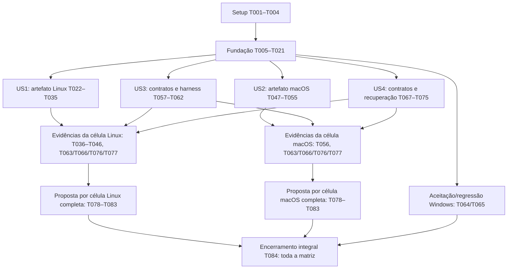

# Tasks: Uso do Desembaraça Twine em Linux e macOS

**Prioridade de integração macOS em 2026-10-20**: ampliado driver real `tests/integration/test_macos_runtime.py`, reutilizando o percurso Linux parametrizado, sem substituir o gerenciador/motor por mocks. Confere primeiro uso/preparo explícito, Library/Caches isolado, probe no destino final antes de ready, modos, corpus/preservação, Mach-O/dependências e estado Gatekeeper/SIP antes/depois. Driver de aceitação instalada exige assinatura/spctl pelo worker existente. Workflow Intel/Apple Silicon executa ambos os Pythons; confirmação nativa pendente deste checkpoint. Aquisição controlada e bloqueio de rede somente Python são explícitos. T048 permanece aberta até conferir o CI e o critério de candidata distribuída; T051/T056 mantêm assinatura/aceitação próprias. Fundação local: 217 testes por Python, oito skips; total **54/84**.

**Fontes das candidatas atuais recuperadas em 2026-10-20**: o verificador aceita `--project-lock` com pin explícito de commit completo, repositório/raiz fixados e tamanho/hash conferidos; mantém o pin padrão anterior. As [quatro exportações da revisão `4784410`](evidence/public-source-recovery-current-2026-10-20/summary.json) foram confrontadas com o ZIP público sem autenticação, Graphviz e SDK: 18.173 fontes por variante (70 do projeto, 18.102 SDK e tarball Graphviz), mais dois metadados gerados separados. Proveniências correspondem aos quatro bundles nativos atuais. 217 testes de fundação passam em cada Python, oito skips por execução. T030 continua parcial para aplicabilidade/ISO, terceiros e retenção/oferta; total **54/84**. Alterações locais, sem commit necessário nesta etapa.

**Obrigações confirmadas nos pacotes em 2026-10-20**: checkpoint acumulado `47844106ff072cad005a8a1c795153c658b2bc89` enviado para CI; [cinco workflows e quatro pacotes conferidos](evidence/linux-component-obligations-ci-2026-10-20/summary.json) confirmam os sete materiais W3C/ISO e o reconhecimento ColorBrewer, além do COPYRIGHT musl suplementar em glibc ARM64. Novos totais: glibc x64 479 avisos/referências, glibc ARM64 543 e musl 420 por arquitetura. Motores preservados, corpus/cache offline nos dois Pythons e reconstruções aprovados; [seis jobs de fundação](evidence/github-actions-foundation-obligations-2026-10-20.json) com 216 testes cada. Evidências finais locais, sem novo commit de metadados. T030 permanece aberta para aplicabilidade/ISO, proveniências de terceiros e oferta/retenção de fontes; total **54/84**.

**Obrigações por componente em 2026-10-20**: [revisão local](evidence/linux-component-obligations-2026-10-20/summary.json) acrescenta reconhecimento explícito ColorBrewer e COPYRIGHT musl nas candidatas glibc com evidência de fontes de runtime. Ambas lacunas foram reproduzidas em testes antes da correção; 216 testes de fundação passam por Python, oito skips em cada. Revisão por componente em `tools/runtime/licenses/LINUX-COMPONENT-REVIEW.md`; a resposta pública W3C não foi tratada como autorização ISO. Alterações acumuladas de recuperação pública/avisos serão enviadas juntas para confirmação nativa. T030 permanece parcial, total **54/84**.

**Revisão W3C/declarações de entidades em 2026-10-20**: preservados termos datados, copyright/status das publicações e três avisos ISO encontrados dentro das declarações de entidades. O preparador Linux gera sete materiais offline, vinculados aos dados do próprio build; [revisão local](evidence/w3c-policy-review-2026-10-20/summary.json) confere os inputs das quatro candidatas, sem alterar os ZIPs anteriores. 216 testes de fundação passaram por Python, oito skips em cada; adulterações e separação dos termos são cobertas. T030 continua parcial: aplicabilidade/condição SGML, demais componentes, retenção/oferta e confirmação nativa dos novos avisos pendentes. Total **54/84**, sem commit neste incremento.

**Recuperação pública das fontes em 2026-10-20**: novo `verify-public-sources.py` conferiu independentemente as quatro exportações da revisão `7d0476f` contra os arquivos públicos fixados do projeto, Graphviz e SDK. [18.162 entradas de fontes por candidata](evidence/public-source-recovery-2026-10-20/summary.json) correspondem byte a byte; dois metadados gerados são tratados separadamente e a proveniência corresponde aos bundles CI atuais. Caminho de recuperação/reconstrução sem depender de Actions documentado em `tools/runtime/REBUILD-SOURCES.md`; 212 testes de fundação aprovados por Python, oito skips em cada. T030 continua parcial: correspondência e disponibilidade observada não aprovam aplicabilidade por arquivo nem política de retenção/oferta. Total **54/84**, sem commit neste incremento.

**Pacotes de avisos confirmados no CI em 2026-10-19**: revisão `7d0476f3943e679ff1e151bf656f9992084209ba` enviada em um único commit necessário aos ensaios nativos. [Cinco workflows aprovados e quatro ZIPs conferidos após download](evidence/linux-source-notice-packages-2026-10-19/summary.json): glibc x64 com 471 avisos/referências, glibc ARM64 com 534 e musl com 412 por arquitetura. Todos preservam 322 fontes observadas, 303 prefixos e duas referências adicionais; bytes dos motores originais inalterados. Corpus, cache offline nos dois Pythons e reconstruções das fontes passaram; [seis jobs de fundação](evidence/github-actions-foundation-source-notices-2026-10-19.json) passaram com 210 testes cada. Evidências finais mantidas localmente para o próximo commit necessário. T030 ainda exige aplicabilidade por arquivo, fechamento transitivo e oferta permanente de fontes; total **54/84**.

**Atribuições internas em 2026-10-19**: o preparo preserva também as fontes completas quando encontra indicadores de licença após os comentários iniciais. A [revisão adicional](evidence/linux-graphviz-source-notices-2026-10-19/additional-references.json) registra dois arquivos (14.802 bytes), incluindo a atribuição MurmurHash e a declaração R-tree. Regressão comprovada antes/depois em pacote sintético; a confirmação dos novos pacotes Linux será feita no CI. T030 ainda parcial, total **54/84**.

**Avisos por fonte Graphviz em 2026-10-19**: o preparador agora reconfere e preserva comentários iniciais de cada fonte original observada, com índices por arquivo e rejeição de duplicatas/caminhos inválidos/hashes divergentes antes da saída. A [coleta local vinculada aos quatro builds](evidence/linux-graphviz-source-notices-2026-10-19/summary.json) conferiu 322 fontes iguais por variante, preservou 303 prefixos (incluindo avisos próprios Randomkit) e registrou 19 arquivos sem prefixo. Testes vermelhos antes da implementação e 210 testes de fundação aprovados por Python após a correção, com oito skips em cada. T030 permanece parcial: revisão de aplicabilidade, fontes transitivas/oferta e novas candidatas CI pendentes. Total **54/84**, alterações locais sem commit.

**Correção local de avisos glibc x64 em 2026-10-19**: o preparador agora inclui os prefixos dos headers SDK, a GPL 3 integral de referência Bison e o índice offline de origens também nessa variante. O [recibo local](evidence/linux-x64-header-notices-2026-10-19.json) registra regressão confirmada contra HEAD e 209 testes de fundação aprovados em cada Python. O build antigo do WSL foi recusado por divergência do hash do Flex; não foi reclassificado como pacote atualizado. Confirmação nativa no próximo CI, auditoria por arquivo e oferta de fontes permanecem pendentes. T030 parcial; total **54/84**, sem novo commit nesta etapa.

**Construção glibc concluída e fontes musl reconstruídas em 2026-10-19**: T028 fechada após [consolidar os dois bundles nativos glibc](evidence/glibc-build-completion-2026-10-19/summary.json), inventários/fontes, relocação/corpus nos dois Pythons e reinspeção ELF; candidatas em `tools/runtime/artifacts/linux-glibc/`, sem aprovação de distribuição. A exportação musl inclui 18.164 arquivos por arquitetura, com 18.102 arquivos SDK reconferidos: [x64](evidence/musl-source-rebuild-2026-10-19/x86_64/summary.json) e [ARM64](evidence/musl-source-rebuild-2026-10-19/aarch64/summary.json). Ambas reconstruções funcionais passaram nos dois Pythons; falha inicial de dependência Python foi corrigida e preservada como falha. T030/T066 continuam parciais, T024/T025 preservam gates de baseline antigo; total **54/84**, 30 pendentes.

**Bundles musl construídos/verificados em 2026-10-19**: T029 concluída para as duas candidatas privadas, com [recibo de construção](evidence/musl-build-completion-2026-10-19.json), arquivos/inventários em `tools/runtime/artifacts/linux-musl/` (ignorados pelo Git) e relatórios rastreáveis. Avisos de [x64](evidence/alpine-musl-sdk-notices-2026-10-19/x86_64/summary.json) e [ARM64](evidence/alpine-musl-sdk-notices-2026-10-19/aarch64/summary.json) incluem 107 itens cada e índice offline; 437/434 fontes SDK e 58 headers por arquitetura conferidos. ELF estático, relocação, corpus e cache offline nos dois Pythons aprovados. T030 mantém auditoria/oferta de fontes pendentes; T026/T027/T044 mantêm cobertura de versões/baseline/qualificação Alpine. Total **53/84**, 31 pendentes, sem suporte POSIX publicado.

**Integração Linux concluída em 2026-10-19**: T023 fechada com [oito slots reais](evidence/linux-runtime-integration-2026-10-19/summary.json), glibc/musl x64/ARM64 nos dois Pythons. Gerenciador de produção, preparo automático/antecipado, cache XDG, modos/probe final, caminhos Unicode e corpus offline passaram sob strace, com 49 execuções dot e zero chamadas de rede por slot. Aquisição é fixture controlada, explicitamente separada do motor real e da qualificação de distribuição. Corrigido erro real no primeiro uso com base XDG inexistente; regressões CI/local aprovadas. Total **52/84**, 32 pendentes.

**Documentação concluída em 2026-10-19**: T035/T055/T079 fechadas após atualizar README PT/EN e quickstart com URL imutável existente, nome atual do comando, venv/caminhos externos, pré-requisitos e estado entregue versus pendente. [Dez ensaios reais](evidence/documented-installation-2026-10-19/summary.json) instalaram a revisão pública em Linux x64/ARM64, macOS Intel/Apple Silicon e Windows, ambos os Pythons, sem Git/Graphviz no PATH. Console e módulos passaram; catálogo POSIX continua pendente. Este é fechamento da documentação e seus comandos disponíveis, sem conceder suporte a plataformas. Total **51/84**, 33 pendentes.

**Fontes musl em 2026-10-19**: relink de [x64](evidence/alpine-musl-link-source-2026-10-19/x86_64/summary.json) e [ARM64](evidence/alpine-musl-link-source-2026-10-19/aarch64/summary.json) preservou os bytes dos motores e vinculou 181 objetos a 322 fontes Graphviz conferidas por arquitetura. Nove entradas geradas e 58 externas registradas; 66 inputs de link, 324/320 extrações. Corpus/rede nos dois Pythons e seis slots CI de fundação aprovados. Localmente, 279 testes completos e 203 de fundação em cada Python. T029/T030 continuam parciais: fontes/avisos SDK, auditoria e qualificação pendentes; total 48/84.

**Builds musl em 2026-10-19**: candidatas estáticas [x64](evidence/alpine-musl-container-2026-10-19/x86_64/summary.json) e [ARM64](evidence/alpine-musl-container-2026-10-19/aarch64/summary.json) construídas com CPU correspondente, SDK fixado e imagens Alpine 3.22 fixadas por digest. ELF/ZIP conferidos após download; 13 casos em Python 3.12.13/3.14.5, sem chamadas de rede e com controles positivos. Ambiente container, kernel do runner Ubuntu: não qualifica células Alpine. T026/T027/T029/T030 parciais; fontes/avisos SDK e aceite por célula pendentes. 202 testes locais em cada Python; total 48/84.

**Reconstrução ARM64 em 2026-10-19**: [recibo das fontes](evidence/linux-arm64-source-rebuild-2026-10-19/summary.json) registra pacote separado de 18.158 arquivos, 18.102 arquivos SDK reconferidos e reconstrução nativa a partir do material exportado, fora do checkout e com cache novo. O motor reconstruído passou pelos 13 casos/relocação/rede; é funcional, mas não byte-idêntico. Corrigido também timeout rolling ligeiramente acima de cinco segundos por arredondamento, com 200 testes locais e regressão CI corrigida aprovada. T030/T066 continuam parciais: oferta permanente, aplicabilidade/licenças e qualificação pendentes; total 48/84.

**Avisos ARM64 em 2026-10-19**: [pacote conferido](evidence/linux-arm64-draft-notices-2026-10-19/summary.json) inclui 229 avisos com índice offline dos outros 228, prefixos de 159 headers e fontes glibc/runtime, textos completos do SDK/LGPL/GPL e avisos Bison/Flex/dados. Todos os 181 headers foram reconferidos; 22 sem prefixo estão registrados. Executável preservado, 13 casos/rede nos dois Pythons aprovados e 198 testes locais passando. T030 parcial: aplicabilidade, demais avisos necessários, fechamento transitivo e oferta de fontes/qualificação continuam pendentes; total 48/84.

**Fontes SDK ARM64 em 2026-10-19**: [recibo nativo](evidence/linux-arm64-sdk-sources-2026-10-19/summary.json) preserva um objeto compiler_rt com 246 fontes SDK conferidas e um builtin gerado, além de três objetos glibc/quatro unidades e cinco fontes. As 251 fontes e seus prefixos/indicadores foram reconferidos contra o tarball fixado após download; executável e corpus preservados. T030 continua parcial: fechamento transitivo, avisos/aplicabilidade e oferta de fontes ainda pendentes. Total 48/84.

**Fontes ARM64 em 2026-10-19**: [captura nativa](evidence/linux-arm64-link-source-2026-10-19/summary.json) vinculou 181 objetos a 322 fontes Graphviz fixadas, nove entradas geradas e 181 externas. O link registrou 73 entradas/148 extrações e preservou os bytes do executável; corpus/rede passaram em ambos os Pythons. O SDK contribuiu com dois membros glibc e um de compiler_rt (`__extendsftf2`), registrado para revisão própria. T028/T030 parciais, sem concluir fontes geradas/SDK, licenças ou qualificação; total 48/84.

**Build ARM64 em 2026-10-19**: [candidata glibc aarch64 nativa](evidence/linux-arm64-native-build-2026-10-19/summary.json) construída no Ubuntu 24.04 ARM64, SDK/compilador fixados por hash. ELF/loader, símbolos até glibc 2.17, relocação Unicode, 13 casos e ausência de chamadas de rede no corpus conferidos nos dois Pythons. Pacote e rastros verificados após download. Avanço parcial de T025/T028/T030; fontes/objetos, avisos completos, baseline antigo e aceite instalado pendentes, sem promoção do catálogo. Total 48/84.

**Feature**: `003-add-cross-platform-support` | **Data**: 2026-10-17

**Input**: [spec.md](spec.md), [plan.md](plan.md), [research.md](research.md), [support-matrix.md](support-matrix.md), [data-model.md](data-model.md), [contracts/](contracts/), [quickstart.md](quickstart.md) e constituição 1.0.1.

**Estado**: implementação parcial em andamento: 54/84 tarefas concluídas, 30 pendentes. Setup, fundação, contratos e ferramentas de qualificação foram implementados e ensaiados; demais variantes POSIX, auditorias e aceitação completa continuam pendentes. O catálogo ativo continua somente Windows. Branch de implementação: `feat/003-add-cross-platform-support`, criada de `dev`; branch anterior `feat/002-manage-layout-runtime` preservada. Ver [validation.md](validation.md) e [ledger de suporte](evidence/support-ledger.md).

**Incremento nativo em 2026-10-19**: build glibc x64 executado no Ubuntu 24.04 hospedado, com fonte/SDK fixados, entradas de link/fontes capturadas e 13 casos do corpus aprovados em CPython 3.12/3.14. Ver [recibo nativo](evidence/github-actions-native-linux-2026-10-19.json). Avança os insumos de T024/T028 e do futuro aceite T036; não conclui auditoria, instalação, rede nativa offline ou a variante ARM64. Checkboxes agregados permanecem abertos.

**Observação nativa de rede em 2026-10-19**: o corpus público dessa candidata passou sob strace no Ubuntu x64, nos dois Pythons, com zero chamadas da classe de rede e controle de conexão em processo filho detectado. Ver [relatório de rede](evidence/linux-network-observation-2026-10-19/summary.json). Esse subensaio não conclui instalação/aquisição/recuperação nem o aceite agregado T036/T080.

**Pacote nativo em 2026-10-19**: CI gerou ZIP glibc x64 com 15 notices vinculados ao build, inventário e conferência do gerador Flex 2.6.4. Hashes/modos dos 16 arquivos foram conferidos após baixar o artefato; corpus e rede passaram nos dois Pythons. Ver [recibo do pacote](evidence/linux-native-notice-package-2026-10-19/summary.json). T028/T030 seguem parciais até completar auditoria de componentes/fontes e qualificação.

**Dados gerados em 2026-10-19**: CI reproduziu em bytes colortbl.h/entities.h a partir dos seis inputs fixados e comparou os valores com W3C/X.Org; cinco diferenças Graphviz registradas. Pacote atualizado com 17 notices e corpus/rede aprovados nos dois Pythons. Ver [evidência dos dados](evidence/linux-native-data-package-2026-10-19/graphviz-data-evidence.json). T030 permanece parcial: correspondência técnica não conclui a cadeia histórica/aplicabilidade de licenças nem a auditoria SDK/fontes.

**Objetos SDK em 2026-10-19**: CI conferiu três objetos/quatro unidades e cinco fontes glibc contra o SDK fixado; preservou os avisos por fonte e corrigiu a ausência da LGPL 2.1 integral. Pacote com 23 notices, corpus/rede nos dois Pythons aprovados. Ver [recibo glibc](evidence/linux-native-glibc-license-package-2026-10-19/summary.json). Declarações/exceções são registradas por arquivo; T028/T030 continuam parciais até revisão completa das obrigações/fontes e qualificação.

**Fontes e reconstrução em 2026-10-19**: pacote separado com 18.150 arquivos, incluindo 18.102 fontes/headers/dados/avisos do SDK e o tarball Graphviz original. Hashes conferidos após download; receitas exportadas reconstruíram o motor no Ubuntu nativo e passaram pelos 13 casos sob strace. A reconstrução é funcional, com binário diferente em bytes. Ver [recibo de reconstrução](evidence/linux-source-rebuild-2026-10-19/summary.json). T030/T066 avançam parcialmente; oferta permanente, revisão por arquivo e qualificação seguem pendentes, sem alterar 46/84.

**Builds macOS em 2026-10-19**: Intel e Apple Silicon compilaram nativamente com Xcode 16.4/SDK 15.5 e passaram em 13 casos e relocação Unicode em cada Python. Bytes Mach-O conferidos após download: mínimo 15.0, sem LC_RPATH, apenas libSystem/libc++ dinâmicas. Ver [recibo inicial](evidence/macos-native-initial-build-2026-10-19/summary.json). T049/T050 avançam parcialmente: a rodada com hashes das ferramentas reais despachadas pelo Xcode e inventário completo do SDK ainda aguarda execução. Assinatura, auditoria e qualificação não foram aprovadas.

**Conclusão dos builds macOS em 2026-10-19**: a rodada consolidada passou em Intel e Apple Silicon. Foram conferidas 37.452 entradas/656.877.420 bytes do SDK, ferramentas reais, pacotes, corpus e load commands. O [recibo consolidado](evidence/macos-native-build-2026-10-19/summary.json) conclui T049/T050, total 48/84. T051/T052/T056 seguem abertas: build nativo não concede assinatura, auditoria ou suporte oficial.

**Insumos da auditoria macOS em 2026-10-19**: mapa do linker vinculou 181 objetos compilados a 322 fontes Graphviz em cada arquitetura; nove entradas geradas e 217 externas registradas. Recibos de [Intel](evidence/macos-link-source-2026-10-19/macos-x86_64/summary.json) e [Apple Silicon](evidence/macos-link-source-2026-10-19/macos-arm64/summary.json), corpus/rede Python nos dois slots e regressões CI aprovados. Ledger macOS iniciado e aviso Flex Apple 35 fixado por revisão/hash. T052 permanece parcial: 181 índices sem nome por mapa, material gerado, SDK e revisão por arquivo continuam pendentes, sem promoção de suporte.

**Rascunhos de avisos macOS em 2026-10-19**: candidatas de [Intel](evidence/macos-draft-notices-2026-10-19/macos-x86_64/summary.json) e [Apple Silicon](evidence/macos-draft-notices-2026-10-19/macos-arm64/summary.json) contêm 227 avisos cada, incluindo prefixos dos 217 headers observados, quatro avisos Bison, Flex Apple e textos Graphviz. Hashes/modos dos 228 arquivos por pacote conferidos após download; executáveis preservados, corpus nos dois Pythons e regressões CI aprovados. T052 continua parcial: textos canônicos completos, aplicabilidade, dados gerados, fontes e assinatura/qualificação seguem pendentes. Total 48/84.

**Textos e índice offline macOS em 2026-10-19**: o preparador inclui referências completas APSL 1.1/2.0, Apache/LLVM e GPL 3, fixadas por origem/hash, mantendo as exceções nos avisos dos geradores. `NOTICE-ORIGINS.json` vincula offline os 231 demais avisos à proveniência e à observação de fontes. Testes locais passam em Python 3.12/3.14 (189 em cada); o [CI da revisão](https://github.com/Extremois/desembaraca-twine/actions/runs/39314104394) valida os pacotes nativos. T052 permanece parcial, sem aprovação de aplicabilidade ou promoção do catálogo; total 48/84.

**Tests**: exigidos explicitamente por FR-007/008/013/016 e SC-001–010. Acrescentar casos de contrato antes do comportamento correspondente, observar falha pertinente e executar regressões após a implementação; testes já corretos podem passar. Não exigir falha artificial do baseline.

**Organization**: setup → fundação → histórias US1/US2/US3 (P1) → US4 (P2) → fechamento. Caminhos são relativos à raiz do repositório. Arquivos novos são entregáveis futuros, não arquivos já existentes.

## Formato e regras de execução

Cada linha usa `- [ ] Tnnn [P?] [USn?] ação com caminho`. `[P]` vale apenas nos grupos de independência descritos adiante e depois de suas precondições; não autoriza edição simultânea do mesmo arquivo. US1–US4 identificam as histórias da spec.

As tarefas de execução por família expandem **todas** as células do registro (versão/canal × arquitetura publicada × variante, mais snapshot_id para rolling), cada uma com exatamente dois slots PythonQualification, 3.12 e 3.14. Python não integra a identidade de SupportTarget. Marcar a tarefa concluída somente quando todos os seus ensaios obrigatórios tiverem evidência. Ambiente/credencial ausente é pendência, não conclusão do ensaio; concluir o harness não conclui a validação. Gates externos não impedem avançar em tarefas independentes.

Tarefas agrupadas de build/auditoria/manifesto e de ensaio são executadas repetidamente por `artifact_id` ou célula, com resultados independentes. Um subresultado completo pode satisfazer a dependência da próxima etapa daquela variante mesmo enquanto o checkbox agregado continua aberto. Não exigir o término de todas as arquiteturas, ABIs ou distribuições para qualificar ou propor a liberação de uma célula pronta. O fechamento agregado continua obrigatório para encerrar a feature.

Não criar VM no computador atual. Não trocar branches, fazer push/publicar releases ou provisionar ambientes/credenciais nesta geração. Builds/ensaios futuros usam recursos existentes/autorizados; quando indisponíveis, manter pendência explícita. Catálogo ativo só contém URLs/hashes reais e qualificados; candidatos locais não são suporte público.

## Phase 1: Setup — baseline e infraestrutura compartilhada

**Goal**: Fixar escopo e evidência sem modificar branches, publicar releases ou criar VM.

**Independent Test / checkpoint**: O registro reproduz a matriz de 2026-10-17 e distingue evidência anterior, ausente e simulada.

### Preparação

- [X] T001 Registrar commit, alterações preexistentes de README/comando e resultados Windows em `specs/003-add-cross-platform-support/validation.md`, preservando as pendências de `specs/002-manage-layout-runtime/validation.md`; não executar mudanças de branch nem converter aceitação limpa/revisão visual em concluídas.
- [X] T002 [P] Criar `tools/runtime/support-targets.json` como registro completo da matriz de `specs/003-add-cross-platform-support/support-matrix.md`, expandindo versões/canais/arquiteturas/variantes e snapshot_id rolling, com exatamente dois slots PythonQualification por SupportTarget e sem Python na chave da célula; registrar fontes/manutenção/elegibilidade gratuita e pendências ARM Manjaro/postmarketOS, minors Mint e snapshots reais ainda não capturados, sem herança ou exclusões silenciosas.
- [X] T003 [P] Criar modelo de evidência em `specs/003-add-cross-platform-support/evidence/README.md` com campos QualificationEvidence de `data-model.md`, incluindo target_id/python_minor, commit/artefato/SHA, imagem/kernel/CPU/Python/origem, inventário/snapshot_id rolling, comandos, hashes, métricas, rede e Twine; aplicar literalmente “Não conter histórias privadas, caminhos pessoais desnecessários ou credenciais.”, publicando somente inventário do ambiente de teste, nunca do usuário.
- [X] T004 [P] Criar `.github/workflows/cross-platform.yml` para testes puros e regressão Windows em CPython 3.12/3.14, com importações específicas condicionadas e identificação de runner/arquitetura; não apresentar job container/emulado ou skip como aprovação nativa de outra célula.

## Phase 2: Foundational — runtime compartilhado

**Goal**: Preparar contratos e provedor comum antes dos incrementos específicos de SO.

**Independent Test / checkpoint**: Testes de contrato/segurança e regressão Windows passam; catálogo sem artefato POSIX continua rejeitando execução incompatível com diagnóstico, sem URL/hash fictícios.

### Testes e modelos compartilhados

- [X] T005 [P] Adaptar `tests/runtime_support.py` e `tests/integration/test_runtime_concurrency.py` para fixtures por SO e imports locais de msvcrt/fcntl; conservar cobertura Windows, declarar skips genuínos e separar teste simulado de ensaio nativo.
- [X] T006 [P] Adicionar `tests/contract/test_runtime_catalog.py`, `tests/unit/test_runtime_platform.py` e `tests/unit/test_runtime_snapshot.py` cobrindo schemas 1/2, ABI, arquitetura traduzida, empate, os-release, cache XDG e symlinks; em snapshot testar canonicalização idêntica com ordem diferente, pacote/canal/kernel alterado, Branch inválido, duplicatas, gerenciador ausente, coleta instável e limites 5 s/8 MiB/100.000 registros, sem rede. Verificar falha antes da implementação correspondente.
- [X] T007 Definir HostEnvironment, SupportTarget, PythonQualification, EnvironmentSnapshot, ArtifactDescriptor e validação de catálogo em `src/twine_edge_overlap/runtime_catalog.py`, com campos/relações de `data-model.md`; cumprir “Unicidade por `(target_id, python_minor)` no registro da revisão qualificada”, exatamente dois slots 3.12/3.14 e status agregado derivado. Cumprir “Resolver exatamente um candidato compatível, por prioridade explícita e identidade estável; empate ambíguo é erro de catálogo.” e “Sem hash/URL fictício ou licença pendente em catálogo ativo.”
- [X] T008 Implementar detecção de SO/Python/arquitetura/os-release/libc/loader/CPU/kernel em `src/twine_edge_overlap/runtime_platform.py` e coleta em `src/twine_edge_overlap/runtime_snapshot.py`, conforme `contracts/support-policy.md#reconhecimento-de-rolling`: consultas pacman/rpm locais fixas, Branch Manjaro por leitura, duas coletas iguais, hash canônico, 5 s/8 MiB agregados e 100.000 registros por leitura. Limite/falha resulta em snapshot desconhecido, não incompatibilidade ABI; não instalar gerenciador nem usar rede. Aplicar “Normalizar amd64/x86_64 para x86_64 e arm64/aarch64 para aarch64 internamente; conservar nomes públicos de cada SO.”, rejeitar tradução/ID_LIKE como prova de compatibilidade.
- [X] T009 Implementar raízes Windows/XDG/macOS e canonicalização da base confiável em `src/twine_edge_overlap/runtime_platform.py`; XDG_CACHE_HOME relativo é ignorado, fallback Linux é ~/.cache, macOS é ~/Library/Caches; proteger caminhos internos, propriedade e modos sem rejeitar aliases ancestrais legítimos.
- [X] T010 Implementar lock msvcrt Windows e flock POSIX em `src/twine_edge_overlap/runtime_platform.py`, prazo de 10 s, revalidação pelo escritor e liberação por descritor/crash; não usar existência do arquivo como posse nem bloquear leitor de geração saudável durante reparo.
- [X] T011 Implementar contexto privado de execução em `src/twine_edge_overlap/runtime_platform.py`: executável/cwd absolutos, allowlist de ambiente, GVBINDIR privado e remoção de redirecionamentos LD_/DYLD_/GV_; não modificar ambiente global nem procurar Graphviz no PATH.
- [X] T012 Adaptar carregamento schema 1 Windows em `src/twine_edge_overlap/runtime.py` e `src/twine_edge_overlap/runtime_catalog.py`; aplicar “A primeira atualização com cache Windows íntegro não deve baixar novamente.”, conservar identidade/cache, ZIP/hashes/notices e interpretação Windows de win32.
- [X] T013 Implementar seleção por SO/arch/ABI/mínimos medidos em `src/twine_edge_overlap/runtime_catalog.py` e criar `src/twine_edge_overlap/runtime-catalog.json` somente com entradas reais já qualificadas; catálogo é empacotado, não consulta latest nem manifesto remoto mutável; requisitos desconhecidos não autorizam fallback. Criar também `src/twine_edge_overlap/support-matrix.json` a partir do registro com novos alvos pendentes, sem alterar o contrato Windows existente.
- [X] T014 Generalizar inventário/extração em `src/twine_edge_overlap/runtime.py`: hashes/tamanhos reais, paths relativos sem travessia/duplicatas/colisões/links/especiais, ZIP 128 MiB, expansão 512 MiB/5.000 entradas; cumprir “Modos POSIX somente de uma lista aprovada (arquivos comuns 0644, executáveis 0755, diretórios privados apropriados), nunca setuid/setgid ou escrita de terceiros.”
- [X] T015 Preservar geração/ready/seletor e identidade OS/arch/ABI/build/hash em `src/twine_edge_overlap/runtime.py`, estados “ausente/alterado → staging → extraido → verificado → instalado → probado → pronto → ativo”; probe no destino final, flush/fsync/fechamento e troca atômica; manter seletor anterior em falha e não coletar gerações antigas.
- [X] T016 Adaptar `src/twine_edge_overlap/engines/process.py` ao POSIX sem flags Windows, shell=False e ambiente privado; garantir término/recolhimento no timeout/cancelamento e tratar filhos caso o bundle os crie, preservando processo de 30 s/8 MiB e probe de 10 s/1 MiB.
- [X] T017 Integrar RuntimeHandle em `src/twine_edge_overlap/application.py` e `src/twine_edge_overlap/engines/graphviz.py`, cumprindo “Resolvido uma vez antes do baseline; permanece válido durante todo o processamento.”; validar entrada antes de adquirir, manter 60 s de processamento e preparação cooperativa separada de 300 s/socket 30 s.
- [X] T018 Atualizar package-data em `pyproject.toml` para catálogo, matriz e runtime_assets qualificados, mantendo comando desembaraca-twine, nome da distribuição/pacote e notices existentes; não empacotar binários de todas as plataformas no wheel nem ampliar a matriz por requires-python.
- [X] T019 [P] Criar base de receitas em `tools/runtime/build-common.py` com seleção por artifact_id, fonte Graphviz 16.1.0 e hashes reais, receita/toolchain/sysroot/imagem rastreáveis, configuração dot/layout/json0 mínima e materialização segura de links no build; cada execução produz resultado independente de outras variantes, sem compilar motor durante instalação do usuário.
- [X] T020 Criar `tools/runtime/verify-artifact.py` para inventário/SBOM/proveniência/fontes/licenças, hashes/tamanhos/modos e fechamento de dependências; reprovar bibliotecas não inventariadas, prefixos absolutos e fontes/notices ausentes antes de aceitar qualquer manifesto.
- [X] T021 Adicionar/executar regressões em `tests/unit/test_runtime_archives.py`, `tests/unit/test_runtime_repair.py` e `tests/integration/test_runtime_budget.py` para limites, identidade Windows, zero rede no cache íntegro, publicação do seletor e permissões; registrar resultados em `specs/003-add-cross-platform-support/validation.md` sem promover SO não ensaiado.

## Phase 3: User Story 1 — Processar uma história no Linux (P1)

**Goal**: Instalar e processar no Linux sem Graphviz manual, em todas as células Linux acordadas, com incremento inicial Ubuntu 24.04 x64/ARM64.

**Independent Test / checkpoint**: Em cada célula Linux, CPython 3.12 e 3.14 nativos: instalar sem checkout, preparar automaticamente/explicitamente, chamar de outra pasta e processar seis referências offline sem tentativa de rede, com resultados (0,0,0) e originais íntegros.

### Testes solicitados pela spec

- [X] T022 [P] [US1] Adicionar `tests/contract/test_cli_linux.py` para instalação/comando/módulo, cwd, caminhos absolutos/relativos, avisos stderr de melhor esforço e rejeição ABI/arch; conservar códigos 0/2/1/130 e os contratos de `contracts/cli.md`.
- [X] T023 [P] [US1] Adicionar `tests/integration/test_linux_runtime.py` para primeira preparação automática/antecipada, cache XDG, modos executáveis, relocação e seis casos offline; observar tentativas de rede, não apenas indisponibilidade, e distinguir fixture simulada de runtime nativo.

### Builds e integração Linux

- [ ] T024 [P] [US1] Criar receita glibc x86_64 em `tools/runtime/linux-glibc-x86_64.json`, fixando fonte/toolchain e baseline que contemple Ubuntu 18.04; medir símbolos, loader, kernel/CPU e RPATH $ORIGIN, sem assumir compatibilidade porque compilou em host recente.
- [ ] T025 [P] [US1] Criar receita glibc aarch64 em `tools/runtime/linux-glibc-aarch64.json`, com toolchain/imagem fixa, baseline para Ubuntu 18.04 e fechamento/relocação privados; usar execução nativa para qualificação, sem emulação como aprovação.
- [ ] T026 [P] [US1] Criar receita musl x86_64 em `tools/runtime/linux-musl-x86_64.json`, cobrindo Alpine 3.21–3.24 com dependências privadas/qualificadas; não presumir que bundle glibc ou pacote community do sistema atende musl.
- [ ] T027 [P] [US1] Criar receita musl aarch64 em `tools/runtime/linux-musl-aarch64.json`, cobrindo Alpine 3.21–3.24 e registrando loader/CPU/kernel reais; conservar os limites de tamanho/contagem do runtime.
- [X] T028 [US1] Construir e verificar cada bundle glibc independentemente, após sua própria receita T024 ou T025, guardando inventários/medições/fontes e relatórios por artifact_id em `tools/runtime/artifacts/linux-glibc/`; usar verify-artifact.py e testar relocação em caminhos com espaços/acentos e dot -Tjson0. Um resultado completo segue para T030/T031 sem esperar a outra arquitetura ou musl; concluir o checkbox somente após os dois bundles.
- [X] T029 [US1] Construir e verificar cada bundle musl independentemente, após sua própria receita T026 ou T027, guardando resultados por artifact_id em `tools/runtime/artifacts/linux-musl/`; cada resultado completo segue para T030/T031 sem esperar outra arquitetura ou glibc. Adicionar variante somente se necessário com justificativa, sem eliminar células incompatíveis por dificuldade; concluir o checkbox somente após os dois bundles.
- [ ] T030 [US1] Auditar por artifact_id licenças de cada dependência Linux e obrigações EPL-2.0/fontes correspondentes em `tools/runtime/licenses/linux.json`, assim que o respectivo resultado T028 ou T029 estiver pronto; preparar notices próprios por build e permitir avanço independente para T031, sem reutilizar automaticamente o inventário Windows ou incorporar componente incompatível. Auditar todas as variantes para concluir o checkbox.
- [ ] T031 [US1] Gerar cada manifesto Linux real em `src/twine_edge_overlap/runtime_assets/` e integrar sua entrada em `src/twine_edge_overlap/runtime-catalog.json` após qualificação, auditoria T030 e disponibilidade de URL HTTPS imutável/hash desse artefato, sem esperar outra variante. Antes disso manter o candidato local em `tools/runtime/artifacts/`, sem publicação externa automática; checkbox agregado permanece aberto enquanto faltar variante obrigatória.
- [X] T032 [US1] Integrar seleção/preparo e aviso Linux em `src/twine_edge_overlap/cli.py` e `src/twine_edge_overlap/runtime.py`, permitindo ABI compatível fora da matriz com aviso e impedindo uso de binário incompatível; manter entrada inválida sem download e histórias/caminhos fora das requisições.
- [ ] T033 [US1] Documentar e ensaiar obtenção de CPython 3.12/3.14 nativos, venv/pip em cada célula Linux em `specs/003-add-cross-platform-support/evidence/linux-prerequisites.md`; não substituir Python do SO, exigir sudo no uso normal ou excluir versões antigas por falta de pacote padrão.
- [X] T034 [US1] Criar `.github/workflows/qualify-linux.yml` consumindo support-targets.json, com pipelines independentes por artefato/célula e sem gate agregado de sucesso da matriz; falha de outra variante não cancela nem bloqueia a célula pronta. Registrar imagem/digest/Python/arquitetura, separar teste userland em container de ensaio nativo SO/kernel e deixar ambiente indisponível pendente.
- [X] T035 [US1] Atualizar seções Linux PT/EN de `README.md` com venv, instalação remota real sem Git, console script/módulo/caminho absoluto, preparo/reparo, offline e limites; apresentar matriz proposta versus validada sem anunciar toda a família como suportada.

### Execução por grupos da matriz (não equivalem à promoção oficial)

- [ ] T036 [US1] Executar instalação/primeiro uso/preparo e seis referências offline em Ubuntu 24.04 x64/ARM64 com ambos os Pythons; registrar hashes, métricas e rede em `specs/003-add-cross-platform-support/evidence/linux-ubuntu-24.04.json`, sem Graphviz global e de fora do checkout.
- [ ] T037 [US1] Executar o mesmo percurso Ubuntu em 18.04, 20.04, 22.04, 26.04 e 26.10 nas duas arquiteturas, em `specs/003-add-cross-platform-support/evidence/linux-ubuntu-other.json`; registrar elegibilidade Pro gratuita para 18.04/20.04 sem armazenar credenciais nem presumir cobertura empresarial.
- [ ] T038 [US1] Executar percurso Linux em Debian 12/13 amd64/arm64 com ambos os Pythons em `specs/003-add-cross-platform-support/evidence/linux-debian.json`, registrando patch e manutenção LTS; não usar resultado Ubuntu como substituto.
- [ ] T039 [US1] Executar percurso Linux em Fedora 43/44 x86_64/aarch64 e ambos os Pythons em `specs/003-add-cross-platform-support/evidence/linux-fedora.json`, sem converter Fedora 45 em release estável ou herdar aprovação RHEL.
- [ ] T040 [US1] Executar percurso Linux em RHEL 8.10/9.8/10.2 x86_64/aarch64 e ambos os Pythons em `specs/003-add-cross-platform-support/evidence/linux-rhel.json`; verificar termos/elegibilidade Developer gratuita do executor antes do ensaio, mantendo indisponibilidade como pendência e não substituindo por Rocky.
- [ ] T041 [US1] Executar percurso Linux em Rocky 8.10/9.8/10.2 e AlmaLinux 8.10/9.8/10.2 nas duas arquiteturas em `specs/003-add-cross-platform-support/evidence/linux-enterprise-derivatives.json`; registrar variantes/requisitos CPU de cada imagem e ambos os Pythons.
- [ ] T042 [US1] Executar percurso Linux em openSUSE Leap 16.0 e Tumbleweed x86_64/aarch64 com ambos os Pythons em `specs/003-add-cross-platform-support/evidence/linux-opensuse.json`; registrar CPU e snapshot/data/digest reais de cada rolling, sem promessa para atualizações futuras.
- [ ] T043 [US1] Executar percurso Linux em Arch x86_64, Arch Linux ARM aarch64 e Manjaro Stable x86_64/ARM64 publicado, em `specs/003-add-cross-platform-support/evidence/linux-arch-manjaro.json`; identificar imagem ARM mantida, registrar snapshots e ambos os Pythons, sem inventar port oficial Arch ARM nem excluir ARM pendente.
- [ ] T044 [US1] Executar percurso Linux em Alpine 3.21/3.22/3.23/3.24 x86_64/aarch64 com ambos os Pythons em `specs/003-add-cross-platform-support/evidence/linux-alpine.json`; registrar série/patch e main versus community, sem depender de Graphviz do sistema.
- [ ] T045 [US1] Executar percurso Linux em Mint 21/21.1/21.2/21.3/22/22.1/22.2/22.3 e LMDE 7 x64, e postmarketOS v26.06 Generic x64/ARM64 publicado em `specs/003-add-cross-platform-support/evidence/linux-mint-postmarketos.json`; identificar imagem/dispositivo ARM concreto sem prometer GUI móvel/drivers, registrar ambos os Pythons e manter indisponível pendente.
- [X] T046 [US1] Consolidar resultados e pendências Linux em `specs/003-add-cross-platform-support/validation.md`, cobrindo US1/AC1–3 para cada célula; ligar às evidências comuns US3/US4 quando disponíveis, sem promover suporte antes dos gates completos de integridade, Twine e recuperação.

## Phase 4: User Story 2 — Processar uma história no macOS (P1)

**Goal**: Usar o mesmo comando nativamente em macOS 15 Intel e Apple Silicon sob proteções normais.

**Independent Test / checkpoint**: Em ambos os Macs e Pythons, instalar candidata assinada/notarizada sem Graphviz/Rosetta, usar pasta externa com acentos/espaços e processar seis referências offline; bloqueio de execução informa recuperação sem bypass.

### Testes solicitados pela spec

- [X] T047 [P] [US2] Adicionar `tests/contract/test_cli_macos.py` para arquitetura nativa/sem Rosetta, cache Library/Caches, chamada externa e erros sem desativar proteções, segundo `contracts/cli.md`.
- [ ] T048 [P] [US2] Adicionar `tests/integration/test_macos_runtime.py` para probe no destino final, relocação @loader_path, permissões, seis referências offline e execução da candidata distribuída sob proteções normais; marcar mocks como simulação.

### Builds e integração macOS

- [X] T049 [P] [US2] Criar receita e construir Graphviz 16.1.0 Darwin x86_64 mínimo em `tools/runtime/macos-x86_64.json`, com deployment target macOS 15, toolchain fixo, bibliotecas privadas e inventário/proveniência/fontes; verificar relocação e saída json0 em Intel nativo.
- [X] T050 [P] [US2] Criar receita e construir Darwin arm64 mínimo em `tools/runtime/macos-arm64.json`, com deployment target macOS 15 e inventário/proveniência/fontes; verificar relocação, bibliotecas e json0 em Apple Silicon nativo, sem assumir equivalência com Intel.
- [ ] T051 [US2] Criar e executar fluxo de assinatura Developer ID/notarização por artifact_id em `tools/runtime/sign-macos.sh`, assim que o build correspondente T049 ou T050 estiver pronto, sem esperar a outra arquitetura; validar toda a cadeia de bibliotecas/executáveis e distribuição desse artefato. Usar credenciais autorizadas sem armazená-las, manter gate pendente se ausentes e não remover quarentena/Gatekeeper; não prometer rebuild assinado idêntico em bytes e concluir o checkbox somente após ambas as variantes.
- [ ] T052 [US2] Auditar licenças/fontes por artifact_id e gerar cada manifesto Darwin em `tools/runtime/licenses/macos.json` e `src/twine_edge_overlap/runtime_assets/`; integrar sua entrada no catálogo após qualificação, auditoria, assinatura T051 e URL/hash reais desse artefato, sem aguardar outra arquitetura. Manter notices offline, componentes externos separados de Apache-2.0 e checkbox agregado aberto enquanto faltar variante obrigatória.
- [X] T053 [US2] Integrar requisitos macOS, ambiente/bibliotecas privadas e diagnóstico de execução em `src/twine_edge_overlap/runtime_platform.py` e `src/twine_edge_overlap/runtime.py`; preservar caminhos Unicode/Library/Caches e nunca usar Rosetta/PATH do motor como solução.
- [X] T054 [US2] Criar `.github/workflows/qualify-macos.yml` com pipelines independentes Intel e ARM nativos e Python 3.12/3.14, sem cancelamento ou gate agregado pelo resultado da outra arquitetura; identificar versão real do SO/toolchain e restringir acesso a credenciais. Cada célula depende somente do próprio artefato assinado e de seus ensaios; job sem assinatura/versão correta não aprova candidata pública.
- [X] T055 [US2] Atualizar seções macOS PT/EN em `README.md` com Python nativo, venv e alternativa sem PATH, instalação remota real, espaço/acesso, preparo/reparo/offline e recuperação sob segurança normal, distinguindo alvos pendentes.
- [ ] T056 [US2] Executar instalação, primeira preparação/uso, caminhos externos e seis referências offline em macOS 15 Intel/Apple Silicon com ambos os Pythons, em `specs/003-add-cross-platform-support/evidence/macos.json`; registrar assinatura/notarização/rede/hashes e pendências, complementando integridade/Twine/recuperação pelos gates comuns antes de promoção.

## Phase 5: User Story 3 — Confiar nos resultados em qualquer sistema (P1)

**Goal**: Preservar dados, não sobrescrever arquivos e manter qualidade/códigos/limites e Windows.

**Independent Test / checkpoint**: Corpus por célula: originais/destinos intactos; cópias semanticamente íntegras; seis casos com (0,0,0) reabertos no Twine; nenhuma métrica aumenta; colisão/falha/cancelamento não anuncia parcial e Windows não regride.

### Testes solicitados pela spec

- [X] T057 [P] [US3] Estender `tests/integration/test_reference_layouts.py` para registrar resultados por artefato/ambiente e verificar “todas não aumentam, seis referências terminam (0,0,0).”, com hashes de entrada e preservação de conteúdo/IDs/metadados/direção/multiplicidade; não exigir coordenadas iguais entre SO.
- [X] T058 [P] [US3] Adicionar `tests/integration/test_cross_platform_publish.py` para exclusão atômica de destino, colisão concorrente, case/Unicode, falha/interrupção e filesystem sem hardlink seguro; verificar originais/destinos por bytes e ausência de publicação parcial.
- [X] T059 [P] [US3] Adicionar `tests/contract/test_cross_platform_results.py` para status/códigos 0/2/1/130, stdout com caminho absoluto/três contagens, stderr diagnóstico, limites 10 MiB/100 nós/300 links/8 KiB e motor indisponível sem sucesso parcial.

### Implementação e evidência de preservação

- [X] T060 [US3] Revisar/adequar `src/twine_edge_overlap/files.py` mantendo publicação Windows e link POSIX do temporário validado para destino inexistente; cumprir “Saída integral verificada antes de publicação atômica sem sobrescrita, ao lado da entrada.”, sem fallback rename sobrescritor/cópia parcial e com diagnóstico em filesystem incapaz.
- [X] T061 [US3] Adequar coordenação/resultado em `src/twine_edge_overlap/application.py` e `src/twine_edge_overlap/cli.py`, conservando invariantes e limites; cumprir “Preparação não produz resultado geométrico; erro de dependência não se transforma em sucesso parcial.” e “Aviso de melhor esforço é independente do status de processamento.”
- [X] T062 [US3] Criar `tools/runtime/qualify-target.py` para executar corpus/instalação/offline e coletar QualificationEvidence vinculada a target_id/python_minor, com hashes/invariantes/métricas/rede e tipo nativo/container/emulado/simulado; consumir support-targets.json, manter slots 3.12/3.14 distintos na mesma revisão/artefato/snapshot_id e nunca interpretar skip como aprovação. Capturar inventário rolling real após ambos os interpretadores disponíveis e verificar ausência de rede na coleta/classificação.
- [ ] T063 [US3] Executar preservação/corpus e reabrir as seis saídas no Twine por célula Linux/macOS disponível, registrando em `specs/003-add-cross-platform-support/evidence/integrity-twine.json` versão Twine, ambiente, revisor e hashes; não substituir revisão visual por parser/screenshot ou retirar célula indisponível.
- [X] T064 [US3] Executar regressão completa Windows 11 x64 com CPython 3.12/3.14 para preparo/reparo/corpus/offline, publicação, limites e cancelamento em `specs/003-add-cross-platform-support/evidence/windows-regression.json`; comprovar reaproveitamento de cache/identidade e notices/hashes schema 1.
- [ ] T065 [US3] Concluir ensaio de instalação em Windows limpo e reabertura visual das seis saídas em ambiente existente autorizado, registrando `specs/003-add-cross-platform-support/evidence/windows-acceptance.json`; não criar VM local, manter tarefa aberta se ambiente/revisão faltar e preservar histórico de `specs/002-manage-layout-runtime/validation.md`.
- [ ] T066 [US3] Verificar licença Apache-2.0, notices/fontes/origens por bundle e acessibilidade offline em wheel/sdist/cache, registrando `specs/003-add-cross-platform-support/evidence/distribution-integrity.json`; reprovar inventário incompleto e impedir inclusão de dependência sem compatibilidade verificada.

## Phase 6: User Story 4 — Entender e recuperar falhas (P2)

**Goal**: Diagnosticar e recuperar preparo/reparo/execução sem perder histórias ou geração saudável; distinguir melhor esforço, incompatibilidade e suporte entregue.

**Independent Test / checkpoint**: Por célula: falhas de rede/integridade/acesso/espaço/execução, interrupção/crash e concorrência preservam arquivos/geração; após reparo falho, processamento segue offline; erros têm causa/impacto/recuperação e promoção parcial não esconde alvos pendentes.

### Testes solicitados pela spec

- [X] T067 [P] [US4] Adicionar `tests/contract/test_runtime_diagnostics.py` para mensagens PT por SO com causa conhecida/impacto/recuperação, stderr e códigos, sem recomendar Graphviz manual, sudo, PATH do motor ou bypass de segurança; causa incerta não deve ser inventada.
- [X] T068 [P] [US4] Adicionar `tests/integration/test_runtime_recovery.py` para falta de rede/espaço/acesso/noexec, download/probe corrompido, reparo falho e repetição após correção; verificar geração anterior utilizável offline e ausência de saída/runtime falsamente prontos.
- [X] T069 [P] [US4] Adicionar `tests/integration/test_runtime_crash.py` para dois preparos, reparo concorrente com handle antigo, término do escritor em staging/promoção e recuperação do lock; verificar seletor/gerações preservados e limpeza somente de recursos próprios.
- [X] T070 [P] [US4] Adicionar `tests/contract/test_support_policy.py` para requisito técnico versus matriz, snapshot igual/alterado/desconhecido e warning de melhor esforço; impedir promoção com um slot Python ausente, 3.12 duplicado em lugar de 3.14, evidências de revisões/artefatos/snapshots distintos, gates comuns incompletos ou simulação. Exigir dois slots nativos da mesma célula/revisão/artefato e fingerprint rolling real antes de suporte oficial, sem bloquear outra célula pronta.

### Implementação e qualificação de recuperação

- [X] T071 [US4] Implementar mapeamento de erros/recuperação por SO em `src/twine_edge_overlap/errors.py` e `src/twine_edge_overlap/cli.py`, cobrindo conexão, integridade, espaço, acesso, execução/segurança e concorrência; preservar dados da história fora dos logs/diagnósticos.
- [X] T072 [US4] Ajustar reparo/rollback em `src/twine_edge_overlap/runtime.py` para conservar geração saudável e seletor em falha/interrupção, repetir após correção e validar cache sem rede; pronto somente após inventário/probe/notices completos.
- [X] T073 [US4] Ajustar crash/lock/limpeza em `src/twine_edge_overlap/runtime.py` e `src/twine_edge_overlap/runtime_platform.py`, sem remover gerações em uso/órfãos como se fossem staging próprio; cumprir “Falha/interrupção remove somente staging/pendências próprias e mantém seletor anterior.” e “não implementar coleta de gerações nesta feature.”
- [X] T074 [US4] Implementar classificação em `src/twine_edge_overlap/runtime_catalog.py` e `src/twine_edge_overlap/support-matrix.json`, com SupportTarget sem Python na chave, dois PythonQualification e estados “pendente → em_qualificacao → validada”; derivar validação agregada dos dois slots/gates comuns consistentes. Usar snapshot_id rolling exato coletado por runtime_snapshot.py e alvo validado empacotado; ausência, atualização, limite ou coleta instável resulta em melhor esforço com aviso se ABI compatível, nunca herança por data/ID_LIKE ou consulta remota. Incompatibilidade ABI permanece erro.
- [X] T075 [US4] Criar `tools/runtime/promote-support.py` para validar evidência e propor atualização por célula independente, exigindo gates US1/US2/US3/US4, dois slots Python únicos e mesma célula/revisão/artefato/snapshot; conferir fingerprint rolling canônico real, rejeitar correspondência ambígua e nunca permitir status agregado editado para contornar gates. Conservar demais pendentes, sem publicar release ou fabricar evidências.
- [ ] T076 [US4] Executar cenários de recuperação/crash/concorrência por célula da matriz em `specs/003-add-cross-platform-support/evidence/recovery.json`, com cache/usuário de teste isolado, sem danificar cache pessoal; registrar simulados/nativos/pendentes e provar processamento offline após reparo falho.
- [X] T077 [US4] Atualizar recuperação PT/EN em `README.md` e critérios em `specs/003-add-cross-platform-support/validation.md`, explicando diferenças de SO, melhor esforço, elegibilidade gratuita, combinação pendente/incompatível e retomada após falha, sem reduzir escopo ou sugerir bypass.

## Phase 7: Polish — fechamento e entrega revisável

**Goal**: Verificar documentação/evidência e preparar incremento revisável; publicação externa permanece ação separada.

**Independent Test / checkpoint**: Todos os requisitos têm tarefa/evidência ou pendência explícita; somente combinações completas são propostas como validadas.

### Verificação transversal

- [ ] T078 Executar instalação remota de candidata real e wheel/sdist em venvs externas por célula/Python, registrando `specs/003-add-cross-platform-support/evidence/package-installation.json`; conferir entrypoint/módulo, ausência de checkout/Git/Graphviz global e modos/manifests/notices presentes no pacote.
- [X] T079 Revisar paridade PT/EN e comandos reais de `README.md` e `specs/003-add-cross-platform-support/quickstart.md`, incluindo precondições Python/venv, caminhos externos, URLs imutáveis existentes, internet, espaço, limites e matriz entregue/pendente; não documentar URL futura como disponível.
- [ ] T080 Auditar limites, privacidade e ausência de mudanças globais em `specs/003-add-cross-platform-support/evidence/security-limits.json`, cobrindo preparação 300 s/socket 30 s/probe 10 s/1 MiB, lock 10 s, processamento 60 s/motor 30 s/8 MiB e ZIP/expansão; coleta rolling com 5 s/8 MiB agregados/100.000 registros por leitura e arquivos de identidade de 64 KiB, dentro do orçamento existente, sem rede nem upload de inventário do usuário/histórias/títulos/caminhos.
- [X] T081 Consolidar ledger completo e rastreabilidade FR-001–018/SC-001–010 em `specs/003-add-cross-platform-support/validation.md`, reconciliando toda célula de support-targets.json com imagens/arquiteturas/ambos Pythons e evidências; manter tarefas de ensaios indisponíveis abertas, mesmo com harness implementado.
- [ ] T082 Executar promote-support.py sobre evidências completas e preparar atualizações revisáveis em `src/twine_edge_overlap/support-matrix.json` e `specs/003-add-cross-platform-support/support-matrix.md`; não promover por mock/container isolado/skip, não apagar versões difíceis nem declarar feature concluída em liberação parcial.
- [ ] T083 Executar os percursos aplicáveis de `specs/003-add-cross-platform-support/quickstart.md` contra os pacotes finais e guardar resultado em `specs/003-add-cross-platform-support/evidence/quickstart.json`, distinguindo demos Ubuntu iniciais, qualificação parcial e matriz inteira.
- [ ] T084 Registrar revisão final dos seis princípios constitucionais e gates de dependências em `specs/003-add-cross-platform-support/validation.md`; preparar resumo de células entregáveis/pendentes e fontes/notices sem publicar; encerrar integralmente apenas se FR/SC cobrem toda a matriz e nenhum ensaio obrigatório permanece aberto.

## Dependencies & Execution Order

### Dependências de fases e histórias

US1 e US2 não dependem funcionalmente uma da outra; ambas usam a fundação. US3 e US4 podem preparar contratos/harness sem aguardar todos os builds, mas sua evidência nativa por célula depende do artefato da célula. Esse é um gate de aceitação, não um ciclo entre histórias. Não aguardar que toda a matriz Linux termine para trabalhar no macOS. Histórias compartilham arquivos: integrar edições serialmente quando se sobrepuserem.

Os ramos Linux/macOS do diagrama são instanciados por artefato/célula, não gates conjuntos das respectivas plataformas. T078–T083 podem produzir uma proposta parcial com demais alvos pendentes; apenas T084 exige o conjunto integral. Manter regressão Windows do código compartilhado antes de qualquer proposta de entrega, sem esperar aceitação limpa adiada para executar testes POSIX independentes.

US1/US2 têm percursos independentes descritos nos seus checkpoints; para **anunciar suporte oficial**, precisam também dos gates comuns US3/US4 daquela célula. A ordem P1/P2 não permite adiar preservação ou recuperação obrigatória para depois de uma release que se anuncie qualificada.

### Precondições por grupo de tarefas

| Grupo | Depende de / ordem |
|---|---|
| T001; T002–T004 | T001 primeiro; T002/T003/T004 independentes entre si |
| T005/T006/T019 | Setup concluído; podem avançar juntos em arquivos distintos |
| T007–T018 | Contratos T006 e registro T002; executar sequencialmente, integrando plataforma/provedor antes de aplicação/empacotamento |
| T020; T021 | T020 após T019 e schema T007; T021 após todas as demais tarefas da fundação |
| T022–T027 | Fundação concluída; contratos/testes/receitas em arquivos distintos |
| T028; T029; T030–T035 | Por artefato: T028 após sua receita T024 ou T025; T029 após sua receita T026 ou T027. T030 recebe somente o build correspondente; T031 recebe sua auditoria/qualificação/URL real. Nenhuma etapa espera outras arquiteturas ou ABIs; integrar edições compartilhadas T032–T035 serialmente |
| T036–T045; T046 | Por célula: harness T062 ou quickstart equivalente, artefato correspondente e integração/pré-requisitos prontos. Não esperar todas as células da família nem conclusão agregada de T028–T035. T046 consolida resultados prontos e pendentes; grupos podem usar ambientes isolados, serializando escrita no ledger |
| T047–T050 | Fundação concluída; testes e receitas distintos. T049/T050 não dependem de Linux |
| T051–T056 | Por artefato: T051 após o build correspondente T049 ou T050 e credenciais autorizadas; T052 após sua própria auditoria/assinatura/URL real. Não exigir a outra arquitetura nem checkbox agregado concluído; T053–T055 integram serialmente, e T056 ensaia cada célula disponível com T062 ou quickstart equivalente |
| T057–T059; T060–T062 | Testes distintos após fundação; T060/T061 implementam contratos antes de T062 executar qualificação |
| T063; T066 | T062 e artefatos/células disponíveis de US1/US2; T066 também precisa dos pacotes finais/inventários. Avaliar por célula sem aprovar o restante |
| T064/T065 | Fundação e integração Windows concluídas; T065 precisa ambiente limpo existente e revisão Twine real. Não aguarda disponibilidade Linux/macOS |
| T067–T070; T071–T075 | Testes independentes após fundação; T071–T075 sequenciais para arquivos compartilhados e schema; T075 só propõe promoção |
| T076; T077 | T076 após T071–T075 e artefato/ambiente da célula; T077 documenta resultados. T076 permanece aberta enquanto houver ensaio obrigatório indisponível |
| T078–T083 | Por célula: pacote/percurso e evidências completos, mais regressão Windows do código compartilhado. T081 mantém ledger de prontas e pendentes; T082 exige gates US1–US4 apenas da célula proposta e não espera outras células, artefatos ou checkboxes agregados |
| T084 | Cobertura integral de todas as tarefas/células, incluindo aceitação Windows; propostas parciais T078–T083 não satisfazem o encerramento |

T031/T052 não autorizam upload: sem origem imutável já disponibilizada mediante autorização, manter manifesto candidato fora do catálogo ativo e tarefa aberta. Pode-se terminar testes locais independentes nesse intervalo. T051/T056/T063/T065/T076 não se tornam concluídas por falta de credenciais, hardware ou interface visual.

## Parallel execution examples

As marcações são oportunidades de execução futura, não instrução para criar agentes nesta geração.

### US1 — Linux

Após T021, executar T022 (contrato CLI), T023 (integração) e receitas T024/T025/T026/T027 em arquivos distintos. Cada build glibc ou musl pronto segue para sua auditoria T030, manifesto T031 e células correspondentes, sem esperar os demais. Depois do harness, células de Debian/Fedora/Alpine podem rodar em ambientes separados, com relatórios distintos; consolidar o ledger depois. Não concorrer T031/T032 com alterações no mesmo catálogo/runtime.

### US2 — macOS

Após T021, T047/T048 e builds T049/T050 têm arquivos/ambientes separados. Cada build Intel ou Apple Silicon pronto segue sozinho para assinatura T051, auditoria/manifesto T052 e ensaios da respectiva célula; indisponibilidade da outra arquitetura não bloqueia esse percurso. Edições no runtime_platform.py e no catálogo devem ser serializadas com outras alterações nesses arquivos.

### US3 — integridade

Após T021, T057/T058/T059 cobrem arquivos de teste distintos. T064 (regressão Windows) pode avançar enquanto builds POSIX são qualificados. T063 requer os artefatos e ambientes reais das células que estiver avaliando; resultados parciais não concluem a tarefa de matriz inteira.

### US4 — recuperação

Após T021, T067/T068/T069/T070 podem ser escritos em paralelo. Após integração T071–T075, ensaios por célula de T076 podem rodar em caches/usuários isolados; juntar evidências de forma serial. Não executar fault injection sobre o cache pessoal do mantenedor.

## Implementation Strategy

### MVP e entrega incremental

1. Terminar setup/fundação com regressão Windows preservada.
2. Implementar caminhos Linux e preparar as quatro receitas, executando o pipeline independentemente por artefato; priorizar glibc Ubuntu 24.04 x64/ARM64 sem esperar musl ou a outra arquitetura para avançar. Preparar contratos/harness US3/US4 desde cedo.
3. Validar cada célula Ubuntu 24.04 com CPython 3.12 e 3.14, instalação remota/wheel/sdist, primeira execução, seis referências offline, preservação, falhas/concorrência e reabertura Twine. Ubuntu 24.04 x64/ARM64 é o **primeiro incremento sugerido**, mas uma dessas arquiteturas já qualificada pode ser proposta independentemente enquanto a outra permanece pendente.
4. Trabalhar macOS e musl sem esperar toda a expansão Linux. Credenciais macOS e imagens ARM ausentes permanecem gates abertos; avançar em trabalho independente.
5. Expandir a todas as versões da matriz: manutenção gratuita condicionada não é automaticamente excluída; rolling tem snapshot real; derivações não herdam suporte.
6. Usar T075/T082 para preparar proposta revisável por célula completa. Publicar não está autorizado por este arquivo. Releases parciais preservam lista de alvos pendentes.
7. Concluir US1 inteira exige todas as suas células; concluir feature exige toda a matriz, US1–US4 e regressão Windows. Um demo Ubuntu não marca as tarefas de matriz completa como feitas.

**Verificação da independência**: glibc x64 pronto pode percorrer T028 → T030 → T031 e qualificar Ubuntu x64 mesmo com glibc ARM64/musl pendentes. Darwin ARM64 pronto pode percorrer T050 → T051 → T052 e qualificar Apple Silicon mesmo com T049 Intel pendente. Cada proposta ainda exige as evidências completas US1/US2/US3/US4 da célula, ambos os Pythons, origem/hash reais e regressão Windows; nenhuma variante ausente recebe aprovação por associação.

### Checkpoints de aceitação por história

| História | Evidência mínima independente |
|---|---|
| US1 | Linux de cada célula: instalação/primeiro uso sem motor global, comando de outra pasta e seis referências offline sem tentativas de rede; ambos os Pythons |
| US2 | macOS 15 Intel/Apple Silicon nativos: candidata assinada/notarizada, caminhos com espaços/acentos, seis referências offline e tratamento seguro de bloqueios; ambos os Pythons |
| US3 | Corpus não regride; seis casos (0,0,0) reabertos no Twine; conteúdo/relacionamentos/bytes de originais preservados; colisão/falha/cancelamento não sobrescreve; Windows mantém contratos |
| US4 | Falhas conhecidas têm causa/impacto/recuperação; crash/concorrência preservam geração; reparo falho permite uso offline anterior; classificação e entrega incremental não confundem ABI com suporte oficial |

### Rastreabilidade de requisitos

| Requisitos | Tarefas principais |
|---|---|
| FR-001/002 | T007–T020, T024–T034, T036–T045, T049–T056 |
| FR-003/017/018 | T002, T013, T032, T033, T070, T074/T075, T081/T082 |
| FR-004/012 | T018, T022, T033/T035, T047/T055, T078/T079 |
| FR-005 | T021/T023, T036–T045, T048/T056, T062/T076 |
| FR-006/007 | T057/T062/T063, corpus da US1/US2 |
| FR-008/009 | T058–T061, T064/T065, T067–T073 |
| FR-010/011 | T010/T015/T016, T067–T077 |
| FR-013 | T001/T004/T012/T021, T064/T065 |
| FR-014 | T019/T020/T030/T031, T049–T052, T066/T080 |
| FR-015 | T011/T032/T062/T071/T080 |
| FR-016 | T003, T036–T046, T056, T062–T066, T076, T078–T084 |

SC-001/004/007: percursos US1/US2 e instalação/documentação final. SC-002/003/006: integridade/publicação/Windows US3. SC-005: recuperação US4. SC-008/009/010: registro de matriz, evidências, promoção e auditoria T081–T084.

## Notes

- 84 tarefas: setup 4, fundação 17, US1 25, US2 10, US3 10, US4 11, fechamento 7.
- 23 tarefas marcadas [P], restritas às precondições e arquivos distintos descritos acima.
- Checkboxes refletem somente tarefas efetivamente verificadas na implementação. Não reimplementar parser/algoritmo se a adequação de plataforma bastar; mudanças necessárias ao corpus devem ter justificativa/evidência.
- Restrições de campos/estados citadas nas tarefas vêm de data-model.md; os contratos e a matriz continuam normativos.
- Registrar em evidência falha real, execução parcial, simulação e ambiente não disponível. Não preencher hashes/URLs/resultados fictícios.
- Commits futuros podem agrupar fundação, runtime Linux, runtime macOS, integridade, recuperação e documentação; não criar commits/branches/push durante a geração de tarefas.
